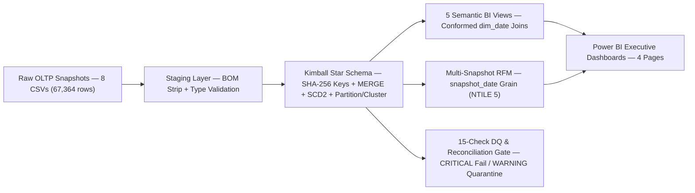
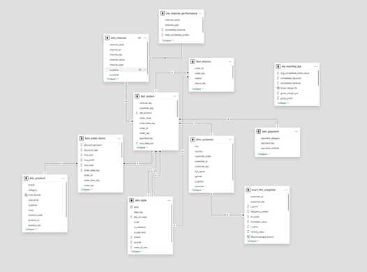
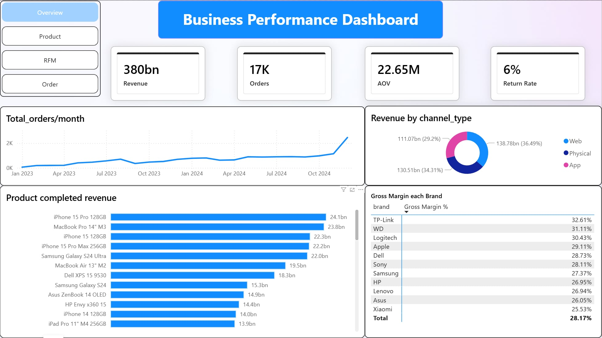
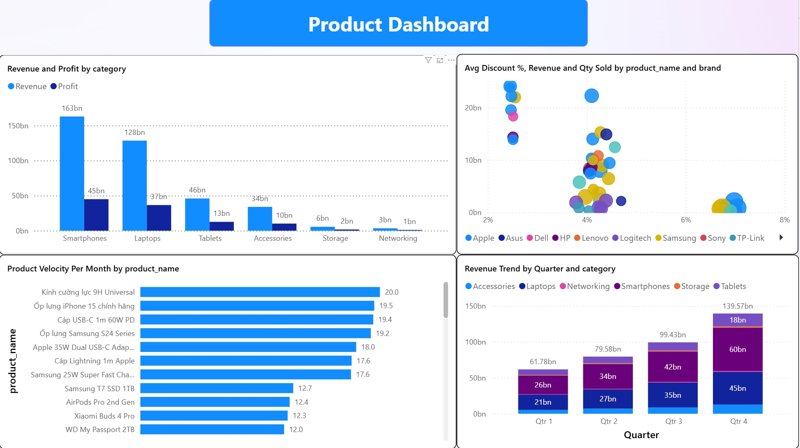
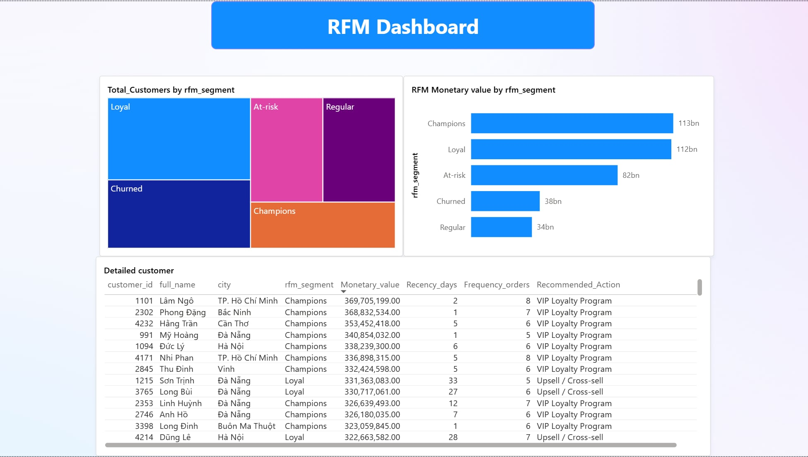

# VietTech Retail BI & Analytics Warehouse — Production-Grade ELT, SCD Type 2 & Data Quality Platform

> **An end-to-end retail Business Intelligence & Analytics Engineering platform built on a Dual-Engine architecture (Google BigQuery Cloud + Zero-Dependency Local SQLite Warehouse) featuring deterministic SHA-256 surrogate keys, `dim_product_scd2` historical margin tracking, watermark-driven incremental CDC (`updated_at`), 3-way financial reconciliation (`0.00 VND` variance), PDPL `91/2025/QH15` PII segregation, automated CI/CD, and 4 Power BI executive dashboards.**


---

## 1. Business Problem Solved

Multi-channel retail chains (`6` physical stores + `Web` + `App`) struggle when operational OLTP databases are queried directly or exported into manual spreadsheets:

1. **Silent KPI Drift & Margin Blindness:** Overwriting product prices/costs (SCD Type 1) destroys historical gross-margin attribution across price revisions (`24` MSRP/COST transitions across `14` SKUs — e.g., `SAM-TAB-A9` margin compressed from `27.00%` to `13.09%`).
2. **Non-Idempotent Full Reloads:** Reloading entire tables with `GENERATE_UUID()` + `WRITE_TRUNCATE` breaks downstream BI bookmarks, wastes BigQuery bytes-scanned budget, and drops late-arriving order status transitions.
3. **Unchecked Source Anomalies & PII Leakage:** Raw operational exports contained **`4` physically impossible returns (`returned_at < order_date`)**, **`333` online completed orders missing `ship_date`** mixed with **`134` physical in-store pickups**, and unmasked customer PII (`email`, `phone`, `date_of_birth`) exposed to analytics consumers.

---

## 2. Architecture & Data Lineage



- **Full C4 Diagrams, Data Lineage & Star Schema ERD:** [`docs/architecture/system-architecture.md`](./docs/architecture/system-architecture.md)
- **Single Source of Truth Metric Dictionary:** [`docs/KPI_GLOSSARY.md`](./docs/KPI_GLOSSARY.md)
- **Vietnamese Engineering Deep-Dive & Interview Playbook (Before -> After + Greenfield Blueprint):** [`docs/ENGINEERING_PLAYBOOK_VI.md`](./docs/ENGINEERING_PLAYBOOK_VI.md)

---

## 3. Verified Results & Empirical Benchmarks (`[SYNTHETIC DATASET]`)

> **Transparency Disclosure:** All numbers below come from the VietTech Electronics **synthetic** multi-channel retail dataset (`21,435` orders, `39,548` order items, `1,288` returns, `5,000` customers, `47` products, `24` price/cost changes across `2023-01-06` to `2024-12-31`), measured empirically on local SQLite `3.49.1` / Python `3.12.10` (`Windows 11`, `16` logical cores). They are **not** production BigQuery traffic. Full reproducible report: [`benchmarks/benchmark_report.md`](./benchmarks/benchmark_report.md) · [`benchmarks/benchmark_results.json`](./benchmarks/benchmark_results.json).

### A. Verified Business & Financial Ground Truth (`0.00 VND` Reconciliation Variance)

| Metric | Verified Value | Governance / Source |
| :--- | ---: | :--- |
| **Total / Completed Orders** | `21,435` / `16,796` | `fact_orders` (`78.36%` completion) |
| **Completed Revenue** | `380,360,467,955 VND` | 3-way reconciled across Raw, `fact_orders`, `fact_order_items`, `vw_monthly_kpi` (`0.0000 VND` diff) |
| **Gross Profit / Gross Margin** | `107,144,233,955 VND` (`28.17%`) | `vw_monthly_kpi` |
| **Return Value / Clean Lead Time** | `29,446,815,953 VND` / `13.11 days` | `1,288` returns (`4` temporal anomalies isolated from lead-time SLA) |
| **SCD Type 2 Product Coverage** | `71` versions / `47` SKUs | `39,548 / 39,548` (`100%`) order lines resolved point-in-time (`0` overlaps) |
| **Top RFM Opportunity (`2025-01-01`)** | `843` At-Risk customers (`81.35B VND`) | `Champions` (`754`, `114.07B`), `Loyal` (`1,305`, `111.96B`), `Churned` (`1,093`, `39.20B`), `Regular` (`843`, `33.78B`) |

### B. Full Refresh vs. Incremental Watermark CDC (`updated_at`)

| Mode | Watermark | Orders Processed | Total Fact Row Reduction | p50 Time (ms) | Speedup |
| :--- | :--- | ---: | ---: | ---: | ---: |
| Full Refresh | `NONE` | `21,435` | `0.00%` | `841.92` | `1.00x` |
| **30-Day Incremental CDC** | `2024-12-02 00:00:00` | `3,116` *(incl. 99 late updates)* | **`85.42%`** | `122.85` | **`6.85x`** |
| **1-Day Incremental CDC** | `2024-12-31 00:00:00` | `485` *(incl. 269 late updates)* | **`97.77%`** | `36.61` | **`23.00x`** |

### C. Query Indexing (`EXPLAIN QUERY PLAN`, 50 Measured Runs) & 15-Check DQ Gate

| Verification Track | Before / Scope | Verified Outcome |
| :--- | :--- | :--- |
| **Q2 — Filtered 2024 Web Orders** | `SCAN fo` (`8.119ms` p50 / `11.979ms` p95) | `SEARCH USING COVERING INDEX idx_fact_orders_status_channel_date` (`2.484ms` p50 — **`3.27x` faster**) |
| **Q1 — 24-Month `vw_monthly_kpi`** | `SCAN fo` (`27.040ms` p50 / `36.706ms` p95) | `COVERING INDEX` on `fact_orders` & `dim_date` (`19.596ms` p50 — **`1.38x` p50 / `1.56x` p95**) |
| **Critical DQ Gates (11 checks)** | PK, FK, 3-way reconciliation, SCD2, PDPL PII, RFM bounds | **`11 / 11 PASS`** (`0` orphans, `0` PII email/phone/DOB columns in `dim_customer`) |
| **Monitored Source Warnings (4 checks)** | Operational & temporal anomaly detection | Caught **`4`** `returned_at < order_date` rows (`[800, 1100, 1187, 1211]`), **`333`** missing online ship dates (separated from `134` physical pickups), **`6`** missing physical shipped dates |

### D. Pre-Ingestion Data Contracts, Lineage DAG & Prescriptive Data Mining (`INT3209E`)

Full reproducible outputs: [`config/data_contracts.json`](./config/data_contracts.json) · [`benchmarks/lineage_manifest.json`](./benchmarks/lineage_manifest.json) · [`benchmarks/analytics_mining_report.md`](./benchmarks/analytics_mining_report.md)

| Enterprise Capability | Method & Guardrails | Verified Empirical Outcome (`[SYNTHETIC]`) |
| :--- | :--- | :--- |
| **Pre-Ingestion Data Contracts & Lineage** | Schema/type/enum/null-rate/volume-drift validator + dead-letter `dq_quarantine_records` + DAG export | `67,364 / 67,364` clean rows (`0` critical schema errors), flags `4` temporal return anomalies pre-load, exports **`38`-node / `70`-edge** PDPL-verified lineage manifest |
| **Market Basket Analysis** (`mart_market_basket_rules`) | Pairwise Support / Confidence / **Lift** on `16,796` Completed baskets (`84` rules persisted) | Top cross-sell: `MacBook -> External SSD & HDD` (**`Lift = 2.559x`**), `MACBOOK-PRO-M3 -> WD-PASSPORT-2TB` (**`Lift = 3.091x`**); exposes popularity trap `Network Switch -> Charger & Cable` (`23.55%` conf yet **`Lift = 0.850x`**) |
| **K-Means++ vs. RFM `NTILE(5)`** (`mart_rfm_kmeans_clusters`) | `log1p + Z-score` scaling (eliminating `>99.9999%` VND Euclidean dominance) across `k=3..6` | Optimal **`k = 3`** (`Silhouette = 0.3594` vs. `0.3088` at `k=5`): `C0 VIP High-Value` (`57.32%` customers) drives **`79.75%`** of revenue |
| **Leakage-Free Return-Risk Scoring** (`mart_return_risk_scores`) | Strictly temporal `2023 train -> 2024 out-of-time test` L2 class-weighted Logistic Regression (order-time features only; point-in-time `returned_at` observability + `26`-order Dec-2023 cutoff maturation gate) | `ROC-AUC = 0.4986`, `PR-AUC = 0.0707` (vs. `0.0704` prevalence) — honestly confirms **0 target leakage** on synthetic i.i.d. random return assignment rather than fabricated AUC |

---

## 4. Power BI Executive Dashboards & Star Schema

| Star Schema Data Mart | Business Performance Dashboard |
| :---: | :---: |
|  |  |
| **Product Performance Dashboard** | **RFM Customer Segmentation Dashboard** |
|  |  |

> Additional Order Operations view available at [`powerbi/dashboard4.jpg`](./powerbi/dashboard4.jpg) and OLTP ERD at [`docs/erd_oltp.png`](./docs/erd_oltp.png).

---

## 5. Key Engineering Trade-offs & ADRs

| ADR | Architectural Decision | Rejected Alternative | Core Trade-off |
| :--- | :--- | :--- | :--- |
| [ADR-001](./docs/decisions/ADR-001-deterministic-surrogate-keys.md) | Deterministic `SHA-256` hash surrogate keys + `MERGE` | `GENERATE_UUID()` + `CREATE OR REPLACE TABLE` | Guarantees 100% idempotent reruns & stable BI joins; slightly wider 64-char hex keys vs `INT64`. |
| [ADR-002](./docs/decisions/ADR-002-scd-type2-product-pricing.md) | `dim_product_scd2` from `product_price_history` | SCD Type 1 current-price overwrite | Enables accurate historical margin analysis across 24 price changes; adds point-in-time join complexity. |
| [ADR-003](./docs/decisions/ADR-003-incremental-watermark-and-partitioning.md) | `updated_at` Watermark CDC + BigQuery `PARTITION`/`CLUSTER` + Local SQLite engine | Full-refresh `WRITE_TRUNCATE` locked behind paid GCP | Cuts incremental rows `85–98%` and makes repo 1-command runnable offline; requires dual-dialect parity tests. |
| [ADR-004](./docs/decisions/ADR-004-data-quality-quarantine-and-pdpl-pii.md) | Tiered DQ quarantine (`CRITICAL`/`WARNING`) + Vietnam PDPL `91/2025/QH15` PII segregation | Silent ingestion or destructive `DELETE` of raw anomalies | Preserves auditability and blocks PII leakage in BI; analysts cannot look up raw phone/email in mart. |

---

## 6. Quick Start

### Option A: Zero-Cloud Local Warehouse, Benchmarks & Automated Tests (Python 3.10+ stdlib only)

```bash
# 0. Validate Pre-Ingestion Data Contracts & emit 38-node Lineage DAG
python scripts/contract_validator.py --emit-lineage benchmarks/lineage_manifest.json

# 1. Build full local Star Schema + SCD2 + RFM + 15-check DQ + Benchmarks (~2 seconds)
python scripts/run_local_warehouse.py --mode full --benchmark

# 2. Run Prescriptive Data Mining (Market Basket Lift, K-Means++ vs RFM, Leakage-Free Return Scoring)
python scripts/analytics_mining.py

# 3. Run incremental watermark CDC simulation
python scripts/run_local_warehouse.py --mode incremental --watermark "2024-12-02 00:00:00"

# 4. Validate BigQuery SQL template rendering & CSV BOM hygiene offline
python scripts/etl_csv_to_bq.py --dry-run
python scripts/run_sql_pipeline.py --dry-run

# 5. Run full automated test suite (20 tests: warehouse + contracts + data mining)
python -m unittest discover -s tests -v
```

### Option B: Docker Compose (Reproducible Containerized Verification)

```bash
docker compose up --build
```

### Option C: Production Google BigQuery Deployment

```bash
cp config/.env.example config/.env   # Set PROJECT_ID and GOOGLE_APPLICATION_CREDENTIALS
pip install -r scripts/requirements.txt
python scripts/etl_csv_to_bq.py
python scripts/run_sql_pipeline.py --mode full --snapshot-date 2025-01-01
```

---

## 7. Known Limitations & 100x Scaling Path

- **Current Scope:** Batch snapshot CSV ingestion (`67,364` total source rows) orchestrated via Python CLI scripts; Power BI `.pbix` binary is excluded from Git to avoid repo bloat (screenshots and exact DAX definitions are version-controlled in `powerbi/` and `docs/KPI_GLOSSARY.md`).
- **Scaling to 100M+ Orders/Month:**
  1. Replace raw SQL orchestration (`run_sql_pipeline.py`) with **dbt** (`models/`, `snapshots/` for SCD2, automated freshness & schema tests, DAG lineage docs).
  2. Replace manual CSV snapshots with **Debezium CDC -> Kafka/PubSub -> Cloud Storage Parquet / Apache Iceberg** staged into BigQuery.
  3. Schedule incremental runs and DQ Slack/PagerDuty alerts via **Apache Airflow** or **Dagster**.
