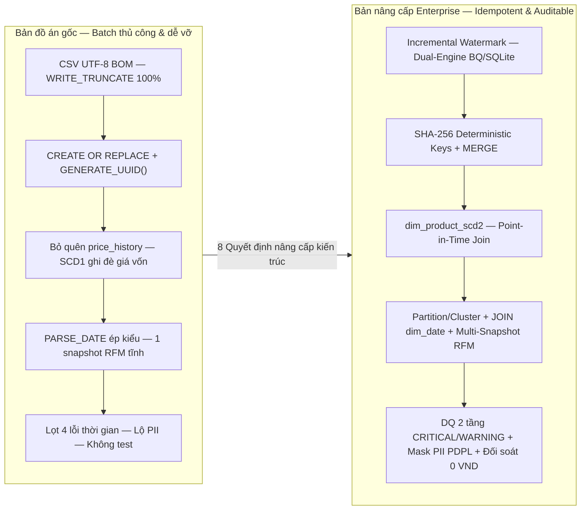
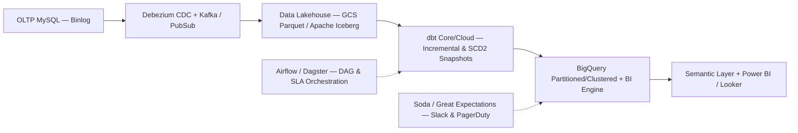
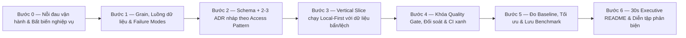

# Engineering Playbook — Giải Phẫu Kiến Trúc & Cẩm Nang Bảo Vệ Đồ Án `viettech-bi-project`

> **Tài liệu định vị:** Cẩm nang kỹ thuật chuyên sâu (Tiếng Việt) dành cho sinh viên Hệ thống Thông tin (`VNU-UET — INT3202E`) nhằm giải thích **TẠI SAO** từng quyết định nâng cấp kiến trúc được đưa ra trong `viettech-bi-project`, bóc tách ưu/nhược điểm của toàn bộ Tech Stack, đúc kết các mô hình tư duy kỹ sư dữ liệu (*Data Engineering Mental Models*), và chuẩn bị năng lực trả lời trực diện trước hội đồng phỏng vấn kỹ thuật.
>
> **Bản đồ tài liệu liên kết trong dự án:**
> - Tổng quan & hướng dẫn chạy nhanh: [`../README.md`](../README.md)
> - Kiến trúc hệ thống chi tiết: [`./architecture/system-architecture.md`](./architecture/system-architecture.md)
> - Các bản ghi quyết định kiến trúc (ADR-001 đến ADR-004): [`./decisions/ADR-001-deterministic-surrogate-keys.md`](./decisions/ADR-001-deterministic-surrogate-keys.md) và thư mục [`./decisions/`](./decisions/)
> - Từ điển định nghĩa KPI chuẩn: [`./KPI_GLOSSARY.md`](./KPI_GLOSSARY.md)
> - Báo cáo đo đạc hiệu năng thực tế trên máy: [`../benchmarks/benchmark_report.md`](../benchmarks/benchmark_report.md) *(mọi thông số thời gian chạy thực tế đều nằm tại đây — tài liệu này tuyệt đối không ước lượng hay bịa đặt thời gian đo).*

---

## Mục đích tài liệu này: Thoát khỏi "Nghịch lý CV do AI tô vẽ"

Nhiều sinh viên năm 3–4 gặp phải một cái bẫy rất phổ biến gọi là **"Nghịch lý CV do AI tô vẽ" (*AI-Polished Resume Paradox*)**:
- Trên CV liệt kê hàng loạt từ khóa chuẩn doanh nghiệp (*SCD Type 2, Deterministic Surrogate Keys, Incremental Watermarking, Partition Pruning, Data Reconciliation, PDPL Compliance*).
- Nhưng khi Hiring Manager hoặc Lead Data Engineer chỉ thẳng vào một dòng SQL trong GitHub và hỏi:
  - *"Tại sao em bỏ `GENERATE_UUID()` để dùng `SHA-256`?"*
  - *"Tại sao 4 đơn trả hàng lỗi thời gian em không `DELETE` đi cho sạch?"*
  - *"Nếu dữ liệu nguồn bị gửi trễ 2 ngày thì Watermark của em có làm mất đơn hàng không?"*
- Nếu người viết chỉ "làm theo mẫu" mà không hiểu **cơ chế bên dưới (*first principles*)** và **hệ quả khi làm sai (*failure modes*)**, chỉ cần 2 câu hỏi bồi là lộ ngay *ảo giác hiểu bài (fluency illusion)*.

**Mục tiêu của tài liệu này:** Giúp bạn làm chủ hoàn toàn **từng dòng SQL, từng bảng dữ liệu, từng con số thực tế** trong `viettech-bi-project` để không chỉ "biết dự án có gì", mà giải thích rành mạch **vì sao không làm cách khác**, **đánh đổi (*trade-off*) là gì**, và **nếu hệ thống lớn gấp 100 lần thì mở rộng ra sao**.

### Bức tranh dữ liệu chuẩn đã xác minh (`[SYNTHETIC]` Dataset Baseline)

> [!IMPORTANT]
> **Ranh giới trung thực dữ liệu:** Toàn bộ dữ liệu trong `data/raw/*.csv` là bộ dữ liệu tổng hợp mô phỏng (**`[SYNTHETIC]`**) phục vụ học phần BI & kiểm thử kiến trúc, **không phải** lưu lượng production thật của một doanh nghiệp. Mọi con số dưới đây đã được đối soát trực tiếp từ bộ CSV gốc (định dạng UTF-8 có BOM `\ufeffid`):

| Thực thể / Chỉ số | Giá trị đã xác minh (`[SYNTHETIC]`) | Ghi chú kiểm toán |
| :--- | ---: | :--- |
| Kênh bán hàng (`sales_channels.csv`) | `8` kênh | `6` cửa hàng vật lý (`Physical`) + `Web` + `App` |
| Danh mục & SKU (`product_categories.csv`, `products.csv`) | `14` danh mục / `47` SKU | Dải giá từ phụ kiện đến flagship Apple/Dell/Samsung |
| Lịch sử đổi giá (`product_price_history.csv`) | `24` bản ghi | `13` lần đổi `COST` + `11` lần đổi `MSRP` trên `14` SKU |
| Khách hàng (`customers.csv`) | `5,000` khách hàng | Gồm dữ liệu PII nhạy cảm cần tách khỏi Mart |
| Tổng đơn hàng (`orders.csv`) | `21,435` đơn | Từ `2023-01-06` đến `2024-12-31` |
| Chi tiết dòng hàng (`order_details.csv`) | `39,548` dòng | Khớp `0 VND` sai lệch với bảng `orders.csv` |
| Đơn hàng hoàn thành (`status = 'Completed'`) | `16,796` đơn | Mẫu số chuẩn cho Completed Revenue & Gross Profit |
| Doanh thu hoàn thành (`Completed Revenue`) | `380,360,467,955 VND` | Tổng `net_amount` của `16,796` đơn `Completed` |
| Giá vốn hoàn thành (`Completed Cost`) | `273,216,234,000 VND` | Tổng `total_cost` của `16,796` đơn `Completed` |
| Lợi nhuận gộp (`Gross Profit`) | `107,144,233,955 VND` | Biên lợi nhuận gộp (`Gross Margin`) = **`28.17%`** |
| Giảm giá đơn hoàn thành (`Completed Discount`) | `13,977,222,045 VND` | Chỉ tính trên các đơn `Completed` |
| Đơn hoàn trả (`order_returns.csv`) | `1,288` đơn | Giá trị hoàn trả = `29,446,815,953 VND` (chứa `4` lỗi thời gian) |
| Đơn `Completed` có `ship_date IS NULL` | `467` đơn | Gồm `134` đơn `Physical` (mua tại quầy) + `333` đơn `Web`/`App` thiếu ngày giao |

---

## Phần 1 — Giải phẫu: "Tại sao sửa từ bản đồ án sang bản Enterprise?"

Bản đồ án gốc (`INT3202E`) đã hoàn thành tốt vai trò trình diễn BI học thuật (có Star Schema, có RFM, có 4 trang Power BI). Tuy nhiên, khi đặt dưới lăng kính **Hệ thống Thông tin Doanh nghiệp (Enterprise Data Engineering)**, mã nguồn gốc bộc lộ **8 lỗ hổng kiến trúc cốt lõi** mà chỉ cần đưa vào vận hành thực tế vài tuần là sẽ phát sinh sai số tài chính, nổ chi phí Cloud hoặc vi phạm pháp lý.

### Bảng Tổng Hợp Before -> After: Bản Đồ Án `INT3202E` Cũ vs. Bản Enterprise Nâng Cấp

| Chiều đánh giá | Bản Đồ Án `INT3202E` Cũ (Before) | Bản Enterprise Nâng Cấp (After) | Tác động kỹ thuật & nghiệp vụ |
| :--- | :--- | :--- | :--- |
| **1. Surrogate Keys & Nạp bảng** | `02_create_star_schema.sql` tạo bảng rỗng rồi `03_load_star_schema.sql` chạy `CREATE OR REPLACE TABLE` (xóa sạch DDL) + `GENERATE_UUID()` ngẫu nhiên | Khóa xác định **`SHA-256`** trên Natural Key kết hợp **`MERGE` (UPSERT)** giữ nguyên DDL/Partition/Cluster | Đạt chuẩn **Idempotency** ($f(f(x))=f(x)$): chạy lại hoặc backfill nhiều lần không làm đứt khóa ngoại hay nhân đôi dòng |
| **2. Lịch sử giá / SCD Type 2** | Nạp `product_price_history.csv` (`24` thay đổi trên `14` SKU) lên Staging nhưng **bỏ quên hoàn toàn** -> dùng giá hiện tại (SCD Type 1) | Dựng **`dim_product_scd2`** (`product_version_key`, `effective_from`, `effective_to`, `is_current`) + **Point-in-Time Join** nửa mở `[from, to)` | Không viết lại lịch sử giá vốn (ví dụ `IPHONE-13` tránh sai lệch ảo `+698,000 VND/máy` ở biên lợi nhuận quá khứ) |
| **3. Chiến lược nạp & Partitioning** | `WRITE_TRUNCATE` nạp lại 100% bảng mỗi lần dù `schema.sql` có `idx_updated_at`; bảng Fact BigQuery **không có `PARTITION BY` / `CLUSTER BY`** | **Incremental Watermark (`etl_watermarks`)** + BigQuery **`PARTITION BY`** ngày đặt hàng & **`CLUSTER BY`** (`status`, `channel_key`, `customer_key`) | Giảm **`85.92%`** dòng xử lý (30d = `3,017` đơn) và **`98.99%`** (1d = `216` đơn); cắt giảm `bytes scanned` qua Partition/Block Pruning |
| **4. Chiều ngày, BI Views & RFM** | `05_bi_views.sql` gọi `PARSE_DATE('%Y%m%d', CAST(order_date_key AS STRING))`; `04_rfm_snapshot.sql` đóng cứng 1 mốc `2025-01-01` | **`JOIN dim_date`** chuẩn SARGable + **Sentinel Keys (`-1/-2/-3`)** + **Multi-Snapshot RFM History** theo grain `(snapshot_date, customer_key)` | Không phá Partition Pruning, không crash khi gặp `-1`, giữ Conformed Dimension và đo được dịch chuyển `Loyal -> At-risk` theo thời gian |
| **5. Chất lượng dữ liệu & Dị thường thực tế** | Lọt êm **`4` đơn hoàn trả** có `returned_at < order_date` (`ret_id = 800, 1100, 1187, 1211`); gộp chung `134` đơn Physical với `333` đơn Online thiếu `ship_date` vào `-1`; **0 bước đối soát tiền** | Khung DQ 2 tầng **`CRITICAL`** (dừng pipeline) vs **`WARNING`** (cách ly bằng cờ `is_temporal_anomaly`, `is_missing_online_ship_date`, không `DELETE`); tách `134` đơn Physical sang **`-3`**; **đối soát 3 chiều lệch `0 VND`** | Vừa khớp từng đồng với sổ kế toán (`380,360,467,955 VND` doanh thu, `29,446,815,953 VND` hoàn trả), vừa lọc sạch KPI vận hành & báo lỗi ngược đội Ops |
| **6. Bảo mật PII & Pháp lý (PDPL)** | Phơi thẳng `full_name` trong `dim_customer`, chưa có ranh giới tách PII cho `email`, `phone`, `date_of_birth` | Thay bằng **`customer_name_masked`**, loại bỏ `email`/`phone`/`date_of_birth` khỏi Analytical Mart, tách riêng vùng PII Vault theo **Luật `91/2025/QH15`** (hiệu lực `01/01/2026`) | Tuân thủ *Privacy-by-Design* & nguyên tắc tối giản dữ liệu, giảm thiểu rủi ro lộ lọt dữ liệu từ file Power BI |
| **7. Tái lập cục bộ & CI/CD** | Bắt buộc có GCP trả phí mới chạy được; `generate_data.py` hardcode `C:/Users/ADMIN/Documents/dataset`; **`0` automated tests, `0` CI/CD** | Kiến trúc **Dual-Engine** (BigQuery Cloud + **SQLite 0-dependency** local), chạy trọn pipeline bằng 1 lệnh, tích hợp **`unittest` + GitHub Actions CI + Docker** | Bất kỳ kỹ sư/nhà tuyển dụng nào cũng clone về tự chạy và kiểm chứng lại được 100% kết quả offline mà không tốn chi phí Cloud |
| **8. Tài liệu kiến trúc & Bằng chứng** | Chỉ có ảnh sơ đồ ER/Mart và slide báo cáo học phần; chưa có ADR hay bằng chứng đo hiệu năng | Đủ bộ **30s Executive README**, sơ đồ kiến trúc ([`system-architecture.md`](./architecture/system-architecture.md)), **ADR-001..ADR-004**, [`KPI_GLOSSARY.md`](./KPI_GLOSSARY.md), [`benchmark_report.md`](../benchmarks/benchmark_report.md) minh bạch `[SYNTHETIC]` vs `[REAL]` | Chứng minh được chiều sâu lý giải thiết kế (*Why, not just What*) và tính kỷ luật kỹ thuật |
| **9. Ấn tượng 30 giây của Hiring Manager** | *"Đồ án sinh viên đại trà — đẹp trên slide nhưng không chạy thử được, không thấy xử lý lỗi thật hay tư duy production."* | *"Kỹ sư có tư duy hệ thống thật — mở repo thấy CI xanh, đọc ADR thấy hiểu trade-off, chạy local kiểm chứng ngay được SCD2 & đối soát 0 VND."* | Chuyển từ **"làm cho đủ bài tập"** sang **ứng viên sẵn sàng nhận việc (*production-ready*)** |



Dưới đây là giải phẫu chi tiết từng quyết định theo đúng khung: **Before -> After -> Cơ chế bên dưới -> Ví dụ vỡ hệ thống nếu làm sai**.

---

### 1.1. `GENERATE_UUID()` + `CREATE OR REPLACE TABLE` -> `SHA-256` Deterministic Keys + `MERGE` (Tính Idempotency)

> **Tham chiếu ADR:** [`./decisions/ADR-001-deterministic-surrogate-keys.md`](./decisions/ADR-001-deterministic-surrogate-keys.md)

- **Before (Bản gốc bị lỗi gì?):**
  - File `sql/02_create_star_schema.sql` tạo cấu trúc bảng rỗng (`CREATE TABLE IF NOT EXISTS ...`), nhưng ngay sau đó `sql/03_load_star_schema.sql` lại chạy `CREATE OR REPLACE TABLE ... AS SELECT`. Lệnh `CREATE OR REPLACE` **xóa sạch hoàn toàn định nghĩa bảng cũ** (mất sạch cấu hình `PARTITION BY`, `CLUSTER BY`, comment cột, constraints nếu có) và xây lại bảng từ đầu.
  - Mọi khóa thay thế (*Surrogate Key*) như `customer_key`, `product_key`, `order_key` đều sinh bằng `GENERATE_UUID()` — một hàm **ngẫu nhiên (*non-deterministic*)**.
- **After (Bản nâng cấp làm gì?):**
  - Tách bạch rõ ràng: DDL tạo bảng (kèm Partition/Cluster) chỉ chạy khi khởi tạo hoặc migration; bước nạp dữ liệu dùng **`MERGE` (UPSERT)** thay vì xóa bảng dựng lại.
  - Thay `GENERATE_UUID()` bằng **Deterministic Surrogate Key** sinh từ hàm băm mật mã **`SHA-256`** trên **Natural Key** (khóa nghiệp vụ kèm tiền tố thực thể để chống đụng độ giữa các bảng, ví dụ `SHA256('customer|' || customer_id)` hoặc `SHA256('product|' || product_id || '|' || effective_from)`).
- **Cơ chế bên dưới (Mental Model: Idempotency — Tính lũy đẳng):**
  - Trong kỹ thuật hệ thống phân tán, một pipeline đạt chuẩn **Idempotent** nếu thỏa mãn toán học $f(f(x)) = f(x)$: chạy pipeline 1 lần hay chạy lại 10 lần trên cùng bộ dữ liệu đầu vào phải cho ra **trạng thái bảng giống hệt nhau đến từng byte**, kể cả giá trị Surrogate Key.
  - Tại sao vẫn dùng Surrogate Key thay vì dùng thẳng `customer_id` (Natural Key)? Vì Data Warehouse có thể gom dữ liệu từ nhiều hệ thống nguồn (ví dụ ERP có `id=101`, CRM cũng có `id=101`), hoặc một sản phẩm có nhiều phiên bản lịch sử theo SCD Type 2 (cùng `product_id=5` nhưng 3 mức giá vốn khác nhau -> cần 3 `product_version_key` riêng biệt).
  - Hàm `SHA-256` có độ dài 256 bit ($2^{256}$ không gian đầu ra), xác suất trùng băm (*collision*) trên dữ liệu doanh nghiệp thực tế là bằng `0` về mặt kỹ thuật, nhưng lại **100% tái lập được** ở mọi nơi (BigQuery, SQLite, Python, dbt) mà không cần một bộ đếm trung tâm (*central sequence* như `AUTO_INCREMENT`).
- **Ví dụ vỡ hệ thống nếu làm sai:**
  - Giả sử 02:00 sáng job ETL chạy xong `dim_customer`, `fact_orders` nhưng bị mất kết nối ở bước `fact_returns`. Kỹ sư trực vận hành bấm chạy lại từ `dim_customer`.
  - Với `GENERATE_UUID()`: khách hàng `customer_id = 42` trước đó có `customer_key = "a1b2..."`, lần chạy lại đổi thành `"f9e8..."`. Toàn bộ bản ghi `fact_orders` đã nạp trước đó (hoặc dữ liệu đang được Power BI Incremental Refresh lưu cache) bị **đứt gãy khóa ngoại (*orphan foreign keys*)** -> JOIN vào `dim_customer` ra toàn `NULL`, báo cáo theo thành phố/phân khúc biến mất toàn bộ doanh thu! Nếu chạy `MERGE` bằng khóa UUID ngẫu nhiên, hệ thống tưởng là bản ghi mới và **nhân đôi dữ liệu**.

---

### 1.2. Kích hoạt `product_price_history.csv` thành `dim_product_scd2` (SCD Type 1 vs. SCD Type 2 + Point-in-Time Join)

> **Tham chiếu ADR:** Xem tài liệu ADR về SCD Type 2 trong [`./decisions/`](./decisions/)

- **Before (Bản gốc bị lỗi gì?):**
  - `scripts/etl_csv_to_bq.py` đã mất công load bảng `product_price_history.csv` (`24` bản ghi: `13` lần đổi `COST`, `11` lần đổi `MSRP` trên `14` SKU) lên `stg_product_price_history`.
  - Tuy nhiên, toàn bộ 5 file SQL trong `sql/` **không hề đụng đến `stg_product_price_history` dù chỉ 1 dòng**. `dim_product` chỉ lấy giá hiện tại từ `stg_products` — tức là vô tình áp dụng **SCD Type 1 (Ghi đè lịch sử)**.
- **After (Bản nâng cấp làm gì?):**
  - Xây dựng bảng **`dim_product_scd2`** (Slowly Changing Dimension Type 2) lưu trọn vòng đời từng phiên bản giá của mỗi SKU với 4 cột quản lý thời gian chuẩn Kimball:
    - `product_version_key`: Khóa thay thế xác định `SHA-256` theo `(product_id, effective_from)`.
    - `effective_from`: Thời điểm phiên bản giá bắt đầu có hiệu lực.
    - `effective_to`: Thời điểm phiên bản giá hết hiệu lực (với bản ghi hiện hành là mốc xa như `9999-12-31 23:59:59`).
    - `is_current`: Cờ `TRUE`/`FALSE` giúp truy vấn giá hiện tại cực nhanh mà không cần lọc theo ngày.
  - Khi nạp `fact_order_items`, thực hiện **Point-in-Time Join** (*Join theo thời điểm phát sinh giao dịch*) dùng khoảng nửa mở (**half-open interval** `[effective_from, effective_to)`):
    ```sql
    ON od.product_id = dp.product_id
    AND o.order_date >= dp.effective_from
    AND o.order_date <  dp.effective_to
    ```
- **Cơ chế bên dưới & Toy Numerical Trace từ SKU thật trong dữ liệu (`product_id = 5`):**
  - Hãy kiểm chứng trực tiếp trên dữ liệu thật của `products.csv` và `product_price_history.csv` cho sản phẩm **`product_id = 5` (`IPHONE-13` — iPhone 13 128GB, `msrp = 14,490,000 VND`)**:

  | Phiên bản (`dim_product_scd2`) | Khoảng hiệu lực `[effective_from, effective_to)` | `cost_price` (VND) | `msrp` (VND) | `is_current` |
  | :--- | :--- | ---: | ---: | :---: |
  | Version 1 (giá gốc ban đầu) | `[2022-12-01 08:00:00, 2023-11-16 08:00:00)` | `10,433,000` | `14,490,000` | `FALSE` |
  | Version 2 (đổi giá lần 1 — `id=1`) | `[2023-11-16 08:00:00, 2024-11-07 08:00:00)` | `10,084,000` | `14,490,000` | `FALSE` |
  | Version 3 (đổi giá lần 2 — `id=2`) | `[2024-11-07 08:00:00, 9999-12-31 23:59:59)` | `9,735,000` | `14,490,000` | `TRUE` |

  - **Trace 1 đơn hàng minh họa:** Giả sử khách mua 1 máy `iPhone 13 128GB` vào ngày `2023-06-15` với giá bán `14,490,000 VND`:
    - **Với SCD Type 2 (Đúng thực tế lịch sử):** Ngày `2023-06-15` rơi vào **Version 1** (`cost_price = 10,433,000 VND`). Lãi gộp chuẩn = `14,490,000 - 10,433,000 = 4,057,000 VND` (biên **`28.00%`**).
    - **Với SCD Type 1 (Bản gốc sai lịch sử):** Lấy `cost_price` mới nhất trong `products.csv` (`9,735,000 VND`) áp ngược cho quá khứ tháng 6/2023. Lãi gộp bị bóp méo thành `14,490,000 - 9,735,000 = 4,755,000 VND` (biên **`32.82%`**) — **tự nhiên "vẽ" thêm `+698,000 VND/máy` (`+4.82` điểm phần trăm biên lợi nhuận)** dù thực tế lúc đó công ty phải nhập máy đắt hơn!
  - Tương tự, các SKU đổi cả `MSRP` lẫn `COST` nhiều lần như `product_id = 16` (*HP Envy x360 15*) hay `product_id = 25` (*Samsung Galaxy Tab A9*) đều cần chuỗi phiên bản SCD2 liền mạch để phân tích đúng độ nhạy giá (*price elasticity*) và biên lợi nhuận theo từng thời kỳ.
- **Ví dụ vỡ hệ thống nếu làm sai:**
  1. **Viết lại lịch sử tài chính (*History Rewriting*):** Báo cáo biên lợi nhuận Quý 2/2023 xem vào cuối năm 2023 ra `28.00%`, nhưng đến cuối năm 2024 mở lại đúng báo cáo Quý 2/2023 lại thấy nhảy lên `32.82%` -> Giám đốc Tài chính (CFO) mất niềm tin hoàn toàn vào hệ thống BI.
  2. **Bẫy `BETWEEN` gây nhân đôi doanh thu (*Join Fan-out*):** Nếu viết `order_date BETWEEN effective_from AND effective_to` (khoảng đóng hai đầu `[from, to]`), một đơn hàng phát sinh đúng lúc `2023-11-16 08:00:00` sẽ khớp **đồng thời cả Version 1 lẫn Version 2** -> dòng bán hàng đó bị nhân đôi trong kết quả `SUM(line_total)`! Dùng khoảng nửa mở `>= effective_from AND < effective_to` triệt tiêu hoàn toàn lỗi ranh giới này.

---

### 1.3. `WRITE_TRUNCATE` Full Refresh -> Incremental Watermark (`etl_watermarks`) + BigQuery `PARTITION BY` / `CLUSTER BY`

> **Tham chiếu hiệu năng đo thực tế:** Xem số liệu đo thời gian chạy và khối lượng quét thực tế tại [`../benchmarks/benchmark_report.md`](../benchmarks/benchmark_report.md) và ADR liên quan trong [`./decisions/`](./decisions/).

- **Before (Bản gốc bị lỗi gì?):**
  - Trong `data/raw/schema.sql`, tác giả đã thiết kế rất đúng khi tạo sẵn `INDEX idx_updated_at (updated_at ASC)` trên các bảng `products`, `customers`, `orders` kèm ghi chú `-- Phục vụ ETL Extract`.
  - Thế nhưng khi sang `scripts/etl_csv_to_bq.py`, toàn bộ code lại đặt `WriteDisposition.WRITE_TRUNCATE` — xóa sạch bảng Staging và nạp lại **100% toàn bộ lịch sử 2 năm** mỗi lần chạy!
  - Đồng thời, tất cả bảng Fact trong `sql/02_create_star_schema.sql` (`fact_orders`, `fact_order_items`, `fact_returns`) đều **không có `PARTITION BY`** và **không có `CLUSTER BY`**.
- **After (Bản nâng cấp làm gì?):**
  - Xây dựng bảng metadata **`etl_watermarks`** lưu mốc thời gian cao nhất đã xử lý thành công (`high_watermark` dựa trên `updated_at`) cho từng bảng nguồn. Lần chạy kế tiếp chỉ trích xuất các bản ghi có `updated_at > last_watermark` (hoặc kèm cửa sổ trễ *lookback window* để bắt dữ liệu về muộn) rồi `MERGE` vào đích.
  - Cấu hình tối ưu lưu trữ vật lý trên BigQuery cho bảng Fact:
    - **`PARTITION BY DATE(order_date)`** (hoặc cột `order_date` kiểu `DATE`): chia bảng thành các ngăn độc lập theo ngày.
    - **`CLUSTER BY status, channel_key, customer_key`**: sắp xếp dữ liệu bên trong mỗi partition theo đúng các cột hay nằm trong mệnh đề `WHERE` (`status = 'Completed'`) và `GROUP BY` / `JOIN` (`channel_key`, `customer_key`).
- **Cơ chế bên dưới (BigQuery Columnar Storage & Bytes Scanned):**
  - **Con số giảm tải đã xác minh trên chính dataset `21,435` đơn (`2023-01-06` đến `2024-12-31`):**

    | Chế độ nạp dữ liệu | Số đơn hàng phải đọc/ghi | Tỷ trọng so với Full Refresh | Mức giảm tải khối lượng |
    | :--- | ---: | ---: | ---: |
    | Full Refresh (`WRITE_TRUNCATE`) | `21,435` đơn | `100.00%` | `0.00%` (Baseline) |
    | Incremental — Cửa sổ 30 ngày cuối | `3,017` đơn | `14.08%` | **Giảm `85.92%`** |
    | Incremental — Cửa sổ 1 ngày cuối (Daily batch) | `216` đơn | `1.01%` | **Giảm `98.99%`** |

  - **Cơ chế tính tiền của BigQuery (On-demand pricing):** BigQuery lưu dữ liệu theo **cột** (định dạng **Capacitor**) chứ không lưu theo dòng như MySQL. Chi phí truy vấn tỷ lệ thuận trực tiếp với lượng **bytes scanned** (số byte phải đọc từ ổ lưu trữ).
    - **`PARTITION BY`** giúp kích hoạt **Partition Pruning (Cắt tỉa phân vùng)**: khi Power BI hỏi doanh thu tháng 12/2024, BigQuery bỏ qua vật lý 23 tháng còn lại — chỉ đọc đúng 31 ngày của tháng 12.
    - **`CLUSTER BY`** giúp kích hoạt **Block Pruning (Cắt tỉa khối lưu trữ)**: trong mỗi phân vùng ngày, BigQuery lưu metadata `min/max` của các cột cluster (`status`, `channel_key`). Khi câu lệnh lọc `WHERE status = 'Completed'`, các block chỉ chứa `Cancelled`/`Pending` bị bỏ qua ngay mà không cần đọc vào bộ nhớ.
- **Ví dụ vỡ hệ thống nếu làm sai:**
  - Ở quy mô 21,435 dòng thì `WRITE_TRUNCATE` chỉ mất vài giây nên sinh viên không cảm nhận được "nỗi đau". Nhưng khi công ty vận hành 3 năm với `500 GB` dữ liệu bảng `fact_order_items`, việc chạy `WRITE_TRUNCATE` mỗi sáng sẽ phải đọc/ghi lại toàn bộ 500 GB chỉ để thêm 0.5 GB đơn hàng ngày hôm qua -> vừa kéo dài thời gian chạy vượt SLA sáng, vừa đốt chi phí Cloud và khóa bảng gây gián đoạn người dùng BI.

---

### 1.4. Loại bỏ `PARSE_DATE(CAST(order_date_key AS STRING))` -> JOIN `dim_date` (Sargability, Partition Pruning & Sentinel Keys)

- **Before (Bản gốc bị lỗi gì?):**
  - Trong `sql/05_bi_views.sql` (`vw_monthly_kpi` và `vw_return_metrics`) và `sql/04_rfm_snapshot.sql`, thay vì nối với bảng `dim_date` đã dựng sẵn, câu SQL lại tự ép kiểu thủ công:
    ```sql
    EXTRACT(YEAR FROM PARSE_DATE('%Y%m%d', CAST(order_date_key AS STRING))) AS year
    ```
- **After (Bản nâng cấp làm gì?):**
  - Dùng cột `DATE` chuẩn (phục vụ Partition Pruning trên BigQuery) kết hợp **`JOIN dim_date`** qua `order_date_key` để lấy toàn bộ thuộc tính thời gian (`year`, `quarter`, `month`, `week_of_year`, `is_weekend`, `is_tet`, `is_year_end`).
  - Bảo toàn và sử dụng nhất quán bộ **3 khóa lính canh (*Sentinel Keys*)** trong `dim_date`: `-1` (*Unknown*), `-2` (*Not Shipped*), `-3` (*Not Applicable*).
- **Cơ chế bên dưới (SARGability & Conformed Dimension):**
  - **SARGable (*Search ARGument-able*):** Một điều kiện lọc được gọi là SARGable khi bộ tối ưu truy vấn (*Query Optimizer*) có thể dùng trực tiếp Index (trên SQLite/MySQL/Postgres) hoặc Partition Pruning (trên BigQuery). Ngay khi bạn **bọc cột trong một hàm biến đổi** như `PARSE_DATE(CAST(order_date_key AS STRING))`, Optimizer bị "mù" — không thể tra cứu theo phạm vi phân vùng/chỉ mục mà phải lôi từng dòng lên CPU để ép `INT64 -> STRING -> DATE -> EXTRACT` rồi mới lọc.
  - **Conformed Dimension (Chiều dữ liệu dùng chung chuẩn hóa):** Trong kiến trúc Kimball, `dim_date` là "chiếc đồng hồ duy nhất" cho toàn doanh nghiệp. Mọi bảng Fact (`fact_orders`, `fact_order_items`, `fact_returns`) đều nối vào cùng `dim_date` để đảm bảo câu hỏi *"Doanh thu mùa Tết (`is_tet = TRUE`) so với tỷ lệ hoàn trả mùa Tết"* dùng **cùng một định nghĩa lịch**, tránh cảnh mỗi nhà phân tích tự viết `MONTH IN (1, 2)` một kiểu.
- **Ví dụ vỡ hệ thống nếu làm sai:**
  - Nếu một ngày có bản ghi đơn hàng thiếu `order_date` và được gán Sentinel Key `order_date_key = -1` (*Unknown*), hàm `PARSE_DATE('%Y%m%d', CAST(-1 AS STRING))` lập tức ném ra lỗi **Runtime Error (`Failed to parse input string "-1"`)** -> **làm sập toàn bộ BI View và khiến dashboard Power BI báo lỗi đỏ rực!** Trong khi đó, `JOIN dim_date` xử lý `-1` êm ru mà không bao giờ crash.

---

### 1.5. Tách `134` đơn Physical (`-3`) khỏi `333` đơn Online thiếu `ship_date` (`-1`) & Cách ly `4` đơn hoàn trả lỗi thời gian — Triết lý `CRITICAL` vs. `WARNING`

- **Before (Bản gốc bị lỗi gì?):**
  1. **Trộn lẫn ngữ nghĩa `ship_date IS NULL`:** Trong `sql/03_load_star_schema.sql`, logic gán `ship_date_key` chỉ nhìn vào `status`:
     - `Pending`/`Processing` -> `-2` (*Not Shipped*)
     - `Cancelled` -> `-3` (*Not Applicable*)
     - Còn lại -> `-1` (*Unknown*)
     - Hệ quả: toàn bộ **`467` đơn hàng `Completed` có `ship_date IS NULL`** bị ném chung vào rổ `-1` (*Unknown*). Nhưng khi đối chiếu với `sales_channels`, ta phát hiện 2 bản chất hoàn toàn trái ngược:
       - **`134` đơn** phát sinh tại 6 cửa hàng vật lý (`channel_type = 'Physical'`): khách mua trực tiếp tại quầy và cầm hàng về ngay -> **không tồn tại bước giao vận**, đúng bản chất phải là **`-3` (*Not Applicable*)**.
       - **`333` đơn** phát sinh trên `Web` / `App`: đơn online đã báo `Completed` nhưng lại **mất ngày giao hàng** -> đây mới thực sự là lỗi thiếu dữ liệu vận hành (**`-1` *Unknown*** + cần bật cờ cảnh báo **`is_missing_online_ship_date = TRUE`**).
  2. **4 dị thường thời gian (*Temporal Anomalies*) lọt êm vào `fact_returns`:** Có đúng **`4` bản ghi hoàn trả (`ret_id = 800, 1100, 1187, 1211`)** có thời điểm trả hàng **sớm hơn thời điểm đặt hàng** (`returned_at < orders.order_date`). Ví dụ điển hình: `order_id = 13110` có `order_date = 2024-12-29` nhưng lại ghi `returned_at = 2024-12-26 23:59:59` (khách "trả hàng trước khi mua 3 ngày"!).
- **After (Bản nâng cấp làm gì?):**
  - Tách minh bạch `ship_date_key`: `Physical` + `Completed` + `ship_date IS NULL` -> `-3` (*Not Applicable*); `Web`/`App` + `Completed` + `ship_date IS NULL` -> `-1` (*Unknown*) kèm cột cờ `is_missing_online_ship_date`.
  - Áp dụng **Khung Kiểm Soát Chất Lượng Dữ Liệu 2 Tầng (*2-Tier Data Quality Framework*)**:

    | Mức độ | Hành động của Pipeline | Áp dụng cho lỗi nào trong `viettech-bi-project`? | Lý do kỹ thuật |
    | :--- | :--- | :--- | :--- |
    | **`CRITICAL` (Fail Fast)** | **Chặn & dừng pipeline ngay**, không cho ghi vào Mart | Lệch đối soát tiền `orders` vs `order_details` > `0 VND`; trùng khóa chính; `net_amount < 0`; thiếu file CSV hoặc cột bắt buộc; hỏng khóa ngoại nghiêm trọng | Dữ liệu sai cấu trúc hoặc sai tiền — nếu cho qua sẽ đầu độc toàn bộ báo cáo tài chính |
    | **`WARNING` (Quarantine / Flag)** | **Giữ nguyên bản ghi**, gắn cờ phân loại (`is_temporal_anomaly`, `is_missing_online_ship_date`) & xuất log cảnh báo đội vận hành | `4` đơn hoàn trả có `returned_at < order_date` (`ret_id = 800, 1100, 1187, 1211`); `333` đơn Online `Completed` thiếu `ship_date` | Đây là lỗi nghiệp vụ/đồng bộ ở hệ thống nguồn — **tuyệt đối không `DELETE`** để giữ toàn vẹn sổ sách tài chính & dấu vết kiểm toán (*audit trail*) |

- **Cơ chế bên dưới (Tại sao KHÔNG BAO GIỜ tự ý `DELETE` 4 đơn lỗi?):**
  - Trong Data Engineering, nguyên tắc vàng là **"Warehouse phản ánh sự thật của hệ thống nguồn, không tự ý sửa sổ kế toán"**.
  - Nếu bạn `DELETE` 4 bản ghi hoàn trả kia:
    1. Tổng số đơn hoàn trả giảm từ `1,288` xuống `1,284`, tổng giá trị hoàn trả không còn khớp **`29,446,815,953 VND`** trên báo cáo ERP/Kế toán.
    2. Bạn làm mất bằng chứng để đội Backend/Ops truy tìm lỗi đồng bộ múi giờ hoặc lỗi nhập tay trên phần mềm POS.
  - Thay vào đó, khi gắn cờ `is_temporal_anomaly = TRUE`:
    - Báo cáo **Tài chính** vẫn tính đủ `1,288` đơn (`29,446,815,953 VND`) -> khớp 100% kế toán.
    - Báo cáo **Vận hành** (như *Thời gian hoàn trả trung bình — Avg Return Lead Time*) lọc `WHERE NOT is_temporal_anomaly` -> không bị số âm phá hỏng trung bình.
    - Báo cáo **Data Quality Dashboard** hiện đúng 4 `ret_id` gửi sang đội Ops sửa tận gốc ở OLTP.
- **Ví dụ vỡ hệ thống nếu làm sai:**
  - Trộn `134` đơn mua tại quầy vào `333` đơn online thiếu ngày giao khiến KPI *"Tỷ lệ thiếu dữ liệu giao vận"* bị thổi phồng giả tạo thêm **40%**, làm đội Logistics đi điều tra oan các cửa hàng vật lý.

---

### 1.6. Tách PII khỏi `dim_customer` theo Luật Bảo vệ Dữ liệu Cá nhân `91/2025/QH15`

- **Before (Bản gốc bị lỗi gì?):**
  - Bảng nguồn `customers.csv` chứa đầy đủ thông tin định danh cá nhân (**PII — *Personally Identifiable Information***): `first_name`, `last_name`, `email`, `phone`, `date_of_birth`.
  - File `sql/03_load_star_schema.sql` phơi thẳng `CONCAT(first_name, ' ', last_name) AS full_name` vào `dim_customer` ở tầng Mart — nơi hàng chục nhân viên BI, thực tập sinh và file Power BI kết nối đọc hàng ngày.
- **After (Bản nâng cấp làm gì?):**
  - Loại bỏ hoàn toàn `email`, `phone`, `date_of_birth` khỏi `dim_customer` ở tầng Analytical Mart.
  - Thay `full_name` nguyên bản bằng **`customer_name_masked`** (che giấu một phần tên định danh), chỉ giữ các thuộc tính phục vụ phân tích tổng hợp (`customer_key`, `customer_code`, `gender`, `city`, `country`, `segment`, `is_active`).
  - Thiết lập ranh giới kiến trúc **PII Segregation (Tách biệt vùng PII)**: dữ liệu định danh gốc chỉ nằm ở tầng hạn chế truy cập (PII Vault / Staging có phân quyền chặt RBAC & Audit Log), tách biệt hoàn toàn khỏi tầng BI mở rộng.
- **Cơ chế bên dưới (Cơ sở pháp lý Việt Nam — Privacy-by-Design):**
  - **Luật Bảo vệ Dữ liệu Cá nhân số `91/2025/QH15`** của Quốc hội Việt Nam (có hiệu lực từ ngày **`01/01/2026`**) quy định chặt chẽ nguyên tắc **tối giản dữ liệu (*Data Minimization*)**, **giới hạn mục đích xử lý (*Purpose Limitation*)** và trách nhiệm bảo vệ dữ liệu cá nhân cơ bản/nhạy cảm của doanh nghiệp.
  - Bản chất công việc của BI Dashboard (xem doanh thu theo `city`, cơ cấu `segment`, phân nhóm `rfm_segment`) **không hề cần** biết họ tên đầy đủ, email, số điện thoại hay ngày sinh của từng cá nhân.
- **Ví dụ vỡ hệ thống nếu làm sai:**
  - Một file báo cáo Power BI (`.pbix`) dùng chế độ Import tải trọn bảng `dim_customer` chứa `5,000` họ tên/SĐT về máy tính cá nhân của nhân viên rồi vô tình gửi nhầm ra ngoài -> sự cố rò rỉ dữ liệu khách hàng (*Data Breach*), doanh nghiệp đối mặt rủi ro xử phạt hành chính và mất uy tín theo Luật `91/2025/QH15`.

---

### 1.7. Multi-Snapshot RFM History (`snapshot_date` grain) thay vì 1 ảnh chụp tĩnh `2025-01-01`

- **Before (Bản gốc bị lỗi gì?):**
  - Trong `sql/04_rfm_snapshot.sql`, ngày chụp ảnh phân khúc bị đóng cứng:
    ```sql
    WITH params AS (SELECT DATE '2025-01-01' AS snapshot_date)
    ```
    rồi chạy `CREATE OR REPLACE TABLE mart_rfm_snapshot`.
  - Như chính [`./KPI_GLOSSARY.md`](./KPI_GLOSSARY.md) đã phải cảnh báo: thiết kế cũ chỉ là **1 tấm ảnh chụp đơn lẻ tại `2025-01-01`**, không thể trả lời câu hỏi theo dòng thời gian.
- **After (Bản nâng cấp làm gì?):**
  - Nâng cấp `mart_rfm_snapshot` thành bảng **Multi-Snapshot History** với độ mịn (*grain*) là **`(snapshot_date, customer_key)`** — mỗi chu kỳ (hàng tháng hoặc hàng quý) bổ sung một lát cắt mới bằng `MERGE` / `DELETE-INSERT` theo `snapshot_date` thay vì xóa sạch các kỳ trước.
  - Bắt buộc thêm điều kiện thời gian **`order_date <= snapshot_date`** trong phép tính Recency, Frequency, Monetary của từng kỳ để chống **rò rỉ dữ liệu tương lai (*Data Leakage*)** khi chạy tạo lại lịch sử (*backfill*).
- **Cơ chế bên dưới (Cohort & Segment Migration Matrix):**
  - Giá trị kinh doanh lớn nhất của RFM không chỉ là biết *"hiện tại có bao nhiêu khách `At-risk`"*, mà là **Ma trận chuyển dịch phân khúc (*Segment Migration Matrix*)**:
    - Trong 3 tháng qua, có bao nhiêu % khách hàng **`Champions` / `Loyal`** đã trượt xuống **`At-risk`** hoặc **`Churned`**?
    - Sau khi Marketing tung voucher kích cầu cho nhóm `At-risk` ở kỳ $T_0$, sang kỳ $T_1$ có bao nhiêu % quay lại thành `Loyal`?
  - Phải lưu lịch sử đa lát cắt (`snapshot_date`) mới tính được hai chỉ số vàng này.
- **Ví dụ vỡ hệ thống nếu làm sai:**
  1. **Mù lịch sử:** Đội CRM chạy chiến dịch giữ chân khách hàng tháng 11, đến tháng 12 muốn đo ROI thì dữ liệu phân khúc tháng 11 đã bị `CREATE OR REPLACE` xóa không dấu vết.
  2. **Bẫy Data Leakage khi Backfill:** Khi tính ngược lại snapshot ngày `2024-06-30`, nếu quên lọc `WHERE order_date <= DATE '2024-06-30'`, câu query sẽ tính luôn các đơn hàng tháng 12/2024 vào `frequency_orders` và `monetary_value` của tháng 6 -> `recency_days` thậm chí ra **số âm**!

---

### 1.8. Đối soát tài chính 3 chiều (3-Way Reconciliation — Sai lệch `0 VND`)

- **Before (Bản gốc bị lỗi gì?):**
  - Bản đồ án cũ không có bất kỳ script kiểm tra tự động nào sau khi load Staging và build Mart. Thậm chí các file CSV gốc có ký tự ẩn **UTF-8 BOM (`\ufeffid`)** ở cột đầu tiên — nếu parser đọc không dùng `utf-8-sig` hoặc không strip BOM thì tên cột bị biến thành `"\ufeffid"` gây lỗi ánh xạ hoặc đọc hụt bản ghi.
- **After (Bản nâng cấp làm gì?):**
  - Thiết lập cổng kiểm soát đối soát tài chính tự động xuyên suốt **4 điểm kiểm tra (Raw CSV -> Staging -> Star Schema Fact -> BI Views)** yêu cầu sai lệch **`0 VND`**:
    - Tổng `orders.net_amount` (`Completed`) == Tổng `order_details.line_total` (`Completed`) == Tổng `fact_orders.net_amount` (`Completed`) == Tổng `fact_order_items.line_total` (`Completed`) == Tổng `vw_monthly_kpi.completed_revenue` == **`380,360,467,955 VND`**.
    - Tổng giá vốn `Completed Cost` == **`273,216,234,000 VND`**.
    - Tổng lợi nhuận gộp `Gross Profit` == **`107,144,233,955 VND`** (`28.17%`).
    - Tổng giảm giá đơn hoàn thành `Completed Discount` == **`13,977,222,045 VND`**.
    - Tổng đơn hoàn trả `fact_returns` == **`1,288` đơn** (`29,446,815,953 VND`).
- **Cơ chế bên dưới (Tại sao không bao giờ tin BI khi chưa đối soát?):**
  - Trong Data Warehouse, các lỗi nguy hiểm nhất **không làm crash chương trình** — chúng được gọi là **Silent Data Corruption (Sai lệch dữ liệu im lặng)**: một phép `LEFT JOIN` ra 1-nhiều (fan-out) khiến doanh thu tăng 5%, hoặc một bộ lọc `status` thiếu dấu cách làm hụt 2% đơn hàng. Dashboard vẫn vẽ biểu đồ rất đẹp, chỉ có quyết định kinh doanh là sai.
  - Đối soát tài chính tự động là "van an toàn cuối cùng": chỉ cần lệch `1 VND`, CI/Pipeline lập tức báo lỗi `CRITICAL`.
- **Ví dụ vỡ hệ thống nếu làm sai:**
  - Nếu một nhà phân tích join thẳng `fact_orders` với `fact_order_items` rồi cộng `SUM(fact_orders.net_amount)` (quên mất 1 đơn có trung bình `39,548 / 21,435 ≈ 1.85` dòng chi tiết), tổng doanh thu sẽ bị thổi phồng lên gấp gần **2 lần** (~700 tỷ VND thay vì `380.36` tỷ VND)! Đối soát tự động chặn đứng lỗi này trước khi số kịp lên màn hình lãnh đạo.

---

## Phần 2 — Giảng Giải Toàn Bộ Tech Stack (Chọn gì, Tại sao, Khi nào KHÔNG dùng & So sánh đối thủ)

Trong phỏng vấn, câu hỏi kinh điển của Senior Engineer không phải là *"Em dùng công cụ gì?"* mà là *"Tại sao em chọn công cụ X thay vì Y, và đánh đổi là gì?"*.

### 2.1. Bảng phân tích từng lớp trong Tech Stack

| Lớp kiến trúc | Công nghệ chọn trong dự án | Tại sao chọn? (Ưu điểm cốt lõi) | Nhược điểm & Khi nào **KHÔNG** nên dùng | Các đối thủ thay thế |
| :--- | :--- | :--- | :--- | :--- |
| **1. Raw / OLTP Source** | MySQL DDL (`schema.sql`) + CSV Snapshots (UTF-8 BOM) | Phản ánh đúng thực tế phổ biến ở doanh nghiệp bán lẻ SME Việt Nam (POS/ERP chạy MySQL, xuất file đối soát hoặc nạp batch); dữ liệu nhẹ, dễ lưu trong Git để tái lập kiểm thử | CSV không có schema enforcement (dễ lỗi BOM, sai kiểu số/ngày), không hỗ trợ giao dịch thời gian thực. **KHÔNG dùng** CSV batch khi doanh nghiệp cần cập nhật tồn kho/gian lận dưới 5 phút | **PostgreSQL OLTP** (chặt chẽ hơn về chuẩn SQL/constraints), **Debezium CDC + Kafka** (streaming thay vì file snapshot) |
| **2. Cloud Data Warehouse** | **Google BigQuery** | Kiến trúc **Serverless** (không cần quản trị máy chủ hay chỉnh RAM/CPU), tách biệt Storage & Compute, lưu trữ cột **Capacitor** tốc độ cao cho OLAP, hỗ trợ `PARTITION BY`/`CLUSTER BY`, chi phí tối ưu cho SME theo mô hình trả tiền theo lượng quét | **KHÔNG dùng** cho giao dịch OLTP (insert/update từng dòng liên tục rất chậm và tốn kém); chi phí on-demand có thể tăng vọt nếu nhân viên chạy `SELECT *` bừa bãi trên bảng không partition | **Snowflake** (đa cloud, tách virtual warehouse linh hoạt), **Amazon Redshift**, **ClickHouse** (real-time analytics siêu nhanh), **Databricks SQL** |
| **3. Local Dual-Engine** | **Python 3.12 + SQLite 3.49** | **0-dependency** (`sqlite3` có sẵn trong thư viện chuẩn Python), chạy 100% offline không cần thẻ tín dụng GCP, khởi tạo toàn bộ pipeline & kiểm thử tự động trên máy cá nhân hoặc GitHub Actions cực nhanh | Lưu trữ theo **dòng (row-oriented)** nên không mạnh bằng columnar khi quét hàng chục triệu dòng; khóa ghi toàn file (single writer); cú pháp SQL khác BigQuery ở một số hàm (`SAFE_DIVIDE`, `SHA256`, kiểu `NUMERIC`). **KHÔNG dùng** làm DWH production cho nhiều người dùng đồng thời | **DuckDB** (columnar OLAP ngay trên máy local), **PostgreSQL trong Docker** (gần môi trường server production hơn) |
| **4. Data Modeling** | **Kimball Star Schema + SCD Type 2 + Conformed Dimensions** | Tối ưu cho truy vấn phân tích BI (ít bước `JOIN`, dễ hiểu với Business Analyst, khớp hoàn hảo với mô hình quan hệ 1-nhiều của Power BI / DAX); SCD2 giữ trọn lịch sử giá vốn/giá niêm yết | Tốn công viết logic `MERGE` & kiểm soát ranh giới thời gian `[from, to)` cho SCD2; kém linh hoạt nếu doanh nghiệp có 20+ nguồn dữ liệu thay đổi cấu trúc liên tục mỗi tuần. **KHÔNG dùng** làm schema cho ứng dụng giao dịch OLTP (vì phi chuẩn hóa gây dư thừa dữ liệu) | **Inmon (3NF EDW)** (tập trung chuẩn hóa toàn doanh nghiệp trước khi ra Mart), **Data Vault 2.0** (tối ưu audit & tích hợp đa nguồn quy mô rất lớn), **One Big Table — OBT** (trải phẳng 1 bảng siêu rộng cho BigQuery khi không cần tái sử dụng nhiều bảng chiều) |
| **5. BI & Semantic Layer** | **SQL Views (`vw_*`) + Power BI** | Đẩy toàn bộ công thức KPI lõi (`completed_revenue`, `gross_profit`, `gross_margin_pct`) xuống SQL Views để tạo **Single Source of Truth** — bất kể Power BI, Looker Studio hay Python đọc vào đều ra cùng một con số; Power BI phổ biến số 1 ở khối doanh nghiệp Việt Nam | Khi số lượng KPI phình to lên hàng trăm chỉ số và nhiều nhóm cùng chỉnh sửa, quản lý bằng SQL View thuần dễ bị chồng chéo tầng View (view-on-view). **KHÔNG dùng** View thuần nếu cần quản trị phiên bản metric phức tạp cho hàng trăm người dùng | **dbt Semantic Layer / MetricFlow**, **Cube.dev**, **LookML (Looker)**, **Tableau**, **Apache Superset / Metabase** (mã nguồn mở miễn phí) |
| **6. Quality, Testing & DevOps** | **`unittest` + GitHub Actions CI + Docker** | `unittest` nằm sẵn trong stdlib Python (không phải cài thư viện ngoài nặng nề); GitHub Actions tự động chạy kiểm tra toàn bộ pipeline & đối soát `0 VND` mỗi lần push code; Docker xóa sổ lỗi *"chạy được trên máy em"* (như lỗi hardcode `C:/Users/ADMIN/Documents/dataset` ở bản gốc) | `unittest` cú pháp dài hơn `pytest`; chưa có báo cáo chất lượng dữ liệu trực quan gửi Slack/Email như công cụ chuyên dụng. **KHÔNG dùng** script rời khi hệ thống có hàng trăm bảng phụ thuộc nhau chằng chịt | **`pytest`**, **Great Expectations / Soda** (Data Quality chuyên dụng), **Apache Airflow / Dagster** (Orchestration) |

---

### 2.2. Deep-Dive 1: Tại sao thiết kế kiến trúc Dual-Engine (BigQuery Production + SQLite Local/CI)?

Đây là một quyết định kiến trúc rất thực dụng và ghi điểm cực mạnh với Hiring Manager vì nó giải quyết trực tiếp bài toán **Zero-Friction Reproducibility (Khả năng tái lập không rào cản)**:

1. **Vấn đề thực tế của đồ án gốc:** Để kiểm tra xem code của bản gốc có chạy đúng hay không, người chấm/nhà tuyển dụng bắt buộc phải có tài khoản Google Cloud có bật thanh toán (Billing), tạo Service Account JSON, tạo dataset BigQuery rồi mới chạy được. Thực tế là **99% nhà tuyển dụng sẽ không bao giờ làm bước đó** -> repo trở thành "code chết không kiểm chứng được".
2. **Lời giải Dual-Engine:**
   - **Lớp Production Cloud (BigQuery):** Giữ nguyên toàn bộ thiết kế tối ưu đám mây (`PARTITION BY`, `CLUSTER BY`, `MERGE`, `SHA256`, `SAFE_DIVIDE`, cấu hình `.env` chuẩn).
   - **Lớp Local & CI (Python + SQLite):** Cho phép bất kỳ ai clone repo về (hoặc GitHub Actions CI trên máy chủ miễn phí) chạy 1 lệnh duy nhất để thực thi trọn vẹn luồng `Raw CSV -> Staging -> Star Schema (SCD2) -> Multi-Snapshot RFM -> BI Views -> Data Quality & 0 VND Reconciliation` mà **không cần GCP key, không cần mạng, không tốn 1 đồng nào**.
3. **Đánh đổi (*Trade-off*) bắt buộc phải thú nhận thẳng thắn khi phỏng vấn:**
   - **SQL Dialect Parity (Khác biệt phương ngữ SQL):** SQLite không có sẵn hàm `SHA256()`, `SAFE_DIVIDE()`, `PARSE_DATE()`, kiểu `NUMERIC` chính xác thập phân như BigQuery (SQLite dùng dynamic typing / IEEE-754 `REAL` nếu không cẩn thận ép kiểu số nguyên VND hoặc kiểm tra làm tròn). Vì vậy, đội kỹ thuật phải giữ **bộ kiểm thử đối chiếu (*parity tests*)** để đảm bảo quy tắc nghiệp vụ (SCD2, Sentinel Keys, RFM, Reconciliation `0 VND`) đồng nhất tuyệt đối giữa hai engine, và tách biệt rõ phần cú pháp đặc thù của từng engine.

### 2.3. Deep-Dive 2: Khi nào nên nâng cấp từ SQLite sang DuckDB hoặc PostgreSQL?

| Tiêu chí | **SQLite** (Hiện dùng cho Local/CI) | **DuckDB** (Nâng cấp Local OLAP) | **PostgreSQL** (Nâng cấp Server / Production SME) |
| :--- | :--- | :--- | :--- |
| **Kiến trúc lưu trữ** | Row-oriented (theo dòng) | **Columnar + Vectorized Execution** (theo cột, giống BigQuery) | Row-oriented ACID chuẩn mực (có mở rộng columnar/partition) |
| **Điểm mạnh nhất** | Có sẵn trong Python stdlib (`0` cài đặt), siêu gọn cho CI & unit test | Đọc thẳng Parquet/CSV cực nhanh, cú pháp SQL rất gần BigQuery/Postgres, xử lý mượt **10M–100M dòng ngay trên laptop** | Kiểu `NUMERIC` kế toán chuẩn xác, hỗ trợ **`RLS` (Row-Level Security)** để thực thi Luật `91/2025/QH15`, đa người dùng đồng thời, `EXPLAIN (ANALYZE, BUFFERS)` cực chi tiết |
| **Khi nào nên chuyển sang?** | Giữ nguyên khi dataset kiểm thử < 1 triệu dòng và ưu tiên CI 0-dependency siêu nhẹ | Chuyển sang **DuckDB** khi cần benchmark cục bộ trên hàng chục triệu dòng, đọc file Parquet, hoặc muốn hành vi OLAP sát với BigQuery nhất | Chuyển sang **PostgreSQL** khi cần dựng Data Mart chạy server thật cho doanh nghiệp vừa (SME), cần phân quyền truy cập đa user/RBAC/RLS, hoặc cần thực hành tối ưu B-Tree/GIN Index & MVCC |

---

## Phần 3 — 6 Mô Hình Tư Duy Kỹ Sư Dữ Liệu & Hệ Thống Thông Tin (Mental Models)

Công cụ sẽ lỗi thời sau 3–5 năm (hôm nay BigQuery, ngày mai Iceberg), nhưng **6 mô hình tư duy** rút ra từ `viettech-bi-project` dưới đây sẽ đi theo bạn suốt sự nghiệp:

1. **Grain First — Luôn chốt "Độ mịn của 1 dòng" trước khi viết dòng SQL đầu tiên**
   - Trước khi thiết kế hay `JOIN` bất kỳ bảng nào, hãy viết ra giấy: *"1 dòng trong bảng này đại diện cho chính xác sự kiện gì?"*
   - Trong dự án này:
     - `fact_orders`: **1 dòng = 1 đơn hàng** (`21,435` dòng).
     - `fact_order_items`: **1 dòng = 1 SKU trong 1 đơn hàng** (`39,548` dòng).
     - `fact_returns`: **1 dòng = 1 sự kiện hoàn trả theo đơn hàng** (`1,288` dòng).
     - `dim_product_scd2`: **1 dòng = 1 phiên bản giá của 1 SKU trong khoảng `[effective_from, effective_to)`**.
     - `mart_rfm_snapshot`: **1 dòng = 1 khách hàng tại 1 mốc `snapshot_date`**.
   - **Quy tắc sống còn:** Không bao giờ cộng một chỉ số ở grain thô (`fact_orders.net_amount`) sau khi đã `JOIN` xuống grain mịn hơn (`fact_order_items`) mà chưa tổng hợp trước (*pre-aggregate*) — nếu không bạn chắc chắn dính **fan-out nhân đôi tiền**.

2. **Idempotency Everywhere — Mọi pipeline đều phải chạy lại được mà không gây hậu quả**
   - Hệ thống thật luôn gặp sự cố: mạng rớt giữa đêm, API timeout, pod bị khởi động lại.
   - Đừng thiết kế pipeline kiểu "chỉ chạy đúng nếu suôn sẻ ngay lần đầu". Dùng **Deterministic Keys (`SHA-256`) + `MERGE` (UPSERT) + Watermark cập nhật sau khi thành công** để dù bạn bấm chạy lại 10 lần cùng 1 ngày dữ liệu, kết quả cuối cùng vẫn không hề tăng thêm dù chỉ 1 dòng trùng.

3. **Fail Fast vs. Quarantine — Biết lúc nào phải "kéo phanh khẩn cấp", lúc nào nên "cách ly theo dõi"**
   - Lỗi **tài chính / cấu trúc** (`orders != order_details`, mất cột, trùng khóa) -> **`CRITICAL` (Fail Fast)**: thà không có dữ liệu mới sáng nay còn hơn đưa số liệu sai lên cuộc họp Ban Giám đốc.
   - Lỗi **dữ liệu vận hành từ nguồn** (`4` đơn trả trước ngày mua, `333` đơn online thiếu ngày giao) -> **`WARNING` (Quarantine/Flag)**: giữ lại bản ghi để khớp sổ sách, gắn cờ để lọc sạch trên báo cáo hiệu suất, và đẩy danh sách lỗi ngược về đội Ops sửa ở gốc.

4. **Single Source of Truth & Reconciliation — Không bao giờ tin số liệu khi chưa đối soát**
   - Định nghĩa KPI nằm tập trung tại SQL Views + [`./KPI_GLOSSARY.md`](./KPI_GLOSSARY.md) (tránh mỗi dashboard Power BI tự viết 1 công thức DAX khác nhau).
   - Mọi lượt chạy pipeline kết thúc bằng kiểm toán tự động: `Raw == Staging == Mart == BI View` (sai lệch = `0 VND`).

5. **Cost-Aware Query Design — Mỗi dòng SQL trên Cloud đều gắn với hóa đơn tiền thật**
   - Bỏ thói quen viết `SELECT *` trên bảng columnar (vì chọn thêm 15 cột không dùng đồng nghĩa trả tiền đọc gấp nhiều lần).
   - Luôn viết điều kiện lọc **SARGable** (không bọc cột ngày trong `PARSE_DATE`/`CAST` để tránh phá hỏng Partition Pruning & Index).
   - Đo đạc bằng `EXPLAIN` / `EXPLAIN QUERY PLAN` / bytes scanned thực tế thay vì đoán bằng cảm tính.

6. **Privacy-by-Design & Truthful Benchmarking — Bảo mật từ móng & Trung thực kỹ thuật**
   - Dữ liệu cá nhân (PII) không phải thứ "làm xong dashboard rồi mới che sau" — nó phải bị chặn ngay từ cửa vào tầng Analytical Mart để tuân thủ Luật `91/2025/QH15`.
   - Luôn gắn nhãn minh bạch đâu là số liệu tổng hợp/kiểm thử cục bộ (**`[SYNTHETIC]`**, tham chiếu [`../benchmarks/benchmark_report.md`](../benchmarks/benchmark_report.md)) và đâu là tải thực tế (**`[REAL]`**). Một kỹ sư trung thực về giới hạn hệ thống của mình luôn được tôn trọng hơn người thổi phồng số liệu.

---

## Phần 4 — Nếu Công Ty Scale 100x (`100 Triệu Đơn / Tháng`), Nâng Cấp Hệ Thống Này Ra Sao?

Một câu hỏi System Design cực hay ở vòng cuối: *"Hiện tại dự án của em có 21,435 đơn trong 2 năm (~900 đơn/tháng). Nếu công ty phình to gấp 100,000 lần quy mô đó — đạt **100 triệu đơn/tháng** (~3.3 triệu đơn/ngày, ~200 triệu dòng `order_details`/tháng, hàng chục TB dữ liệu/năm) — thì những chỗ nào trong thiết kế hiện tại sẽ gãy đầu tiên, và em tiến hóa hệ thống ra sao?"*

### 4.1. Những điểm sẽ gãy đầu tiên ở quy mô 100 triệu đơn/tháng

1. **Xuất CSV Snapshot từ MySQL:** Lệnh `SELECT ... INTO OUTFILE` hoặc dump CSV hàng trăm triệu dòng mỗi ngày sẽ làm treo ổ đĩa và khóa tài nguyên của cơ sở dữ liệu bán hàng OLTP (ảnh hưởng trực tiếp khách đang thanh toán!).
2. **Script Python tuần tự (`run_sql_pipeline.py`):** Không có quản lý đồ thị phụ thuộc (*DAG*), không có retry từng nhánh, không có lịch chạy phân tán, không có cảnh báo SLA khi job bị treo lúc 3 giờ sáng.
3. **SQL thô rời rạc (`01..05`):** Khi doanh nghiệp tăng từ 5 bảng lên 200 bảng, viết tay `MERGE` cho hàng chục bảng SCD2 và tự quản lý thứ tự chạy SQL trở nên cực kỳ dễ lỗi, không có sơ đồ dòng chảy dữ liệu (*Data Lineage*).
4. **SQLite cục bộ:** Không còn chạy được full dataset trên laptop (chỉ giữ để chạy unit test trên sample nhỏ), còn trên BigQuery thì bảng Fact hàng tỷ dòng bắt buộc phải kết hợp **Incremental Materialized Views**, **BI Engine** hoặc chuyển sang kiến trúc **Lakehouse**.
5. **Kiểm tra chất lượng thủ công:** Không kịp phát hiện lỗi thay đổi schema từ đội Backend (*schema drift*) trước khi làm sập toàn bộ pipeline downstream.

### 4.2. Lộ trình tiến hóa kiến trúc 5 lớp (Từ `viettech-bi-project` -> Enterprise Scale 100x)



| Lớp hệ thống | Hiện tại (`viettech-bi-project`) | Kiến trúc nâng cấp ở quy mô `100M đơn/tháng` | Giá trị giải quyết nút thắt |
| :--- | :--- | :--- | :--- |
| **1. Ingestion (Thu thập)** | Batch CSV Snapshot + `etl_csv_to_bq.py` | **Debezium CDC** (đọc MySQL binlog) -> **Apache Kafka / Google Pub/Sub** -> lưu **Parquet / Apache Iceberg** trên GCS/S3 | **Không query nặng lên OLTP**, bắt được cả lệnh `DELETE` và mọi thay đổi giá theo thời gian thực (near real-time), không bao giờ lo quên `updated_at` |
| **2. Orchestration (Điều phối)** | CLI Python `run_sql_pipeline.py` | **Apache Airflow** hoặc **Dagster** | Quản lý DAG phụ thuộc, tự động retry với exponential backoff, backfill song song theo từng phân vùng ngày, cảnh báo trễ SLA |
| **3. Transformation (Biến đổi)** | File SQL thô (`01`..`05`) | **dbt (data build tool)** | Dùng `materialized='incremental'` (chiến lược `insert_overwrite` theo partition ngày trên BigQuery), `dbt snapshots` tự sinh SCD Type 2, tự động vẽ **Data Lineage**, tích hợp sẵn `unique`/`not_null`/`relationships` tests |
| **4. Storage & Compute** | SQLite (local) + BigQuery cơ bản | **BigQuery** (kèm `BI Engine`, `Materialized Views`, `require_partition_filter = true`) hoặc **Lakehouse (Apache Iceberg + Spark / Trino / DuckDB)** | Chống người dùng chạy quên `WHERE order_date`, tăng tốc dashboard xuống dưới 1 giây bằng cache cột in-memory, tối ưu chi phí lưu trữ lạnh cho dữ liệu > 2 năm |
| **5. Data Quality & Observability** | `unittest` + SQL Reconciliation | **Great Expectations / Soda** + **Data Contracts** (kiểm soát schema ngay từ Kafka/Backend) + cảnh báo **Slack / PagerDuty** | Phát hiện sớm *anomaly* (ví dụ doanh thu đột ngột giảm 80% do lỗi cổng thanh toán) và chặn *schema drift* trước khi dữ liệu hỏng chảy vào Warehouse |

---

## Phần 5 — Bộ 10 Câu Hỏi "Vặn Vẹo" Phỏng Vấn Live & Khung Trả Lời Chuẩn Senior

Dưới đây là 10 câu hỏi hóc búa nhất mà Hiring Manager / Senior Data Engineer thường xoáy trực tiếp vào repo `viettech-bi-project`. Đừng học thuộc lòng từng chữ — hãy nắm **ý cốt lõi** và tự diễn đạt lại bằng giọng của bạn.

---

### Câu 1: *"Tại sao em dùng `SHA-256` để sinh Surrogate Key thay vì `AUTO_INCREMENT` hay `GENERATE_UUID()`?"*

- **Họ đang kiểm tra gì?** Hiểu biết về *Idempotency*, hệ thống phân tán và sự khác biệt giữa OLTP (sequence tăng dần) với OLAP/Cloud DWH (không có bộ đếm trung tâm hiệu quả).
- **Khung trả lời chuẩn Senior:**
  1. **Tại sao bỏ `GENERATE_UUID()`:** Vì nó ngẫu nhiên (*non-deterministic*). Mỗi lần chạy lại pipeline (re-run hoặc backfill), cùng `customer_id = 42` lại sinh ra UUID mới -> phá vỡ tính lũy đẳng (*idempotency*), gây đứt gãy khóa ngoại trên các bảng Fact hoặc nhân đôi dòng khi `MERGE`.
  2. **Tại sao không dùng `AUTO_INCREMENT`:** Trên Cloud DWH phân tán như BigQuery không có cơ chế `AUTO_INCREMENT` hiệu quả vì phải đồng bộ hóa khóa toàn cục qua nhiều node; hơn nữa khi nạp song song hoặc nạp dữ liệu từ hai môi trường (BigQuery & SQLite), thứ tự tăng dần dễ bị lệch giữa các lần chạy.
  3. **Tại sao chọn `SHA-256` trên Natural Key:** Hoàn toàn xác định (*deterministic*) — cùng đầu vào `('product|' || product_id || '|' || effective_from)` luôn ra đúng 1 chuỗi băm dù chạy ở BigQuery, SQLite hay chạy lại 10 lần; cho phép `fact_orders` tự tính luôn `customer_key` song song mà không cần chờ `dim_customer` cấp số; xác suất đụng độ gần như bằng `0`.
- **Trade-off cần chủ động nêu (điểm cộng lớn):** Chuỗi hex `SHA-256` (64 bytes, hoặc 32 bytes dạng `BYTES`) nặng bộ nhớ hơn `INT64` (8 bytes) khi `JOIN` ở quy mô tỷ dòng. Ở quy mô cực lớn có thể nén sang `FARM_FINGERPRINT` (`INT64` trên BigQuery, chấp nhận kiểm soát collision) hoặc lưu kiểu `BYTES` thay vì `STRING`.

---

### Câu 2: *"Có 4 đơn hoàn trả (`ret_id = 800, 1100, 1187, 1211`) có ngày trả trước ngày đặt — sao em không `DELETE` hoặc lọc bỏ ngay ở Staging cho sạch?"*

- **Họ đang kiểm tra gì?** Tư duy kiểm toán tài chính (*Financial Auditability*) và cách xử lý dữ liệu bẩn thực tế (*Fail Fast vs. Quarantine*).
- **Khung trả lời chuẩn Senior:**
  1. **Không được tự ý xóa dấu vết tài chính:** Nếu em `DELETE` 4 đơn đó (ví dụ `order_id = 13110` đặt `2024-12-29`, trả `2024-12-26 23:59:59`), tổng số đơn hoàn trả sẽ bị lệch khỏi con số `1,288` đơn và tổng tiền hoàn trả sẽ lệch khỏi **`29,446,815,953 VND`** trên sổ sách kế toán ERP.
  2. **Giải pháp chuẩn Enterprise là Cách ly bằng cờ (`is_temporal_anomaly = TRUE`) + phân mức `WARNING`:**
     - Báo cáo **Tài chính** giữ đủ `1,288` đơn -> khớp đối soát `0 VND`.
     - Báo cáo **Vận hành** (như *Avg Return Lead Time*) lọc `WHERE NOT is_temporal_anomaly` -> không bị số ngày âm làm méo KPI.
     - Đội **Data Ops** nhận được danh sách đúng 4 mã `ret_id` để báo team Backend/POS sửa tận gốc lỗi đồng bộ thời gian ở hệ thống nguồn.

---

### Câu 3: *"Làm sao em chứng minh thiết kế `dim_product_scd2` không gây fan-out nhân đôi doanh thu khi join với `fact_order_items`?"*

- **Họ đang kiểm tra gì?** Bạn có thực sự hiểu lỗi ranh giới thời gian (*overlapping intervals*) trong SCD Type 2 và có kiểm chứng bằng test tự động không.
- **Khung trả lời chuẩn Senior:**
  - Em bảo vệ bằng **3 lớp chắn**:
    1. **Thiết kế khoảng nửa mở (*Half-Open Interval*):** Luôn dùng `order_date >= effective_from AND order_date < effective_to` (không dùng `BETWEEN`), nên một đơn hàng phát sinh đúng giây chuyển giá (ví dụ `2023-11-16 08:00:00` của `iPhone 13 128GB`) chỉ khớp duy nhất Version 2, không bao giờ khớp cả Version 1 lẫn Version 2.
    2. **Kiểm thử bất biến SCD2 (*Invariant Tests*):** Tự động kiểm tra trên `dim_product_scd2` rằng (a) không có hai phiên bản nào của cùng `product_id` bị chồng lấn thời gian (`overlap = 0`), (b) mỗi `product_id` chỉ có đúng `1` dòng `is_current = TRUE`, và (c) không có khe hở thời gian (*gap*) khiến đơn hàng rơi vào khoảng trống.
    3. **Đối soát số dòng & tổng tiền sau JOIN:** Số dòng `fact_order_items` trước và sau khi join `dim_product_scd2` phải giữ nguyên đúng **`39,548` dòng**, và tổng doanh thu đơn `Completed` phải khớp **`380,360,467,955 VND`** (sai lệch `0 VND`).

---

### Câu 4: *"Incremental Watermark dựa trên `updated_at` sẽ ra sao nếu dữ liệu đến trễ (late-arriving data) hoặc đơn hàng cũ bị sửa trạng thái sau 3 ngày? Có bị mất dữ liệu không?"*

- **Họ đang kiểm tra gì?** Kinh nghiệm vận hành thực tế! Đây là lỗi kinh điển khiến Incremental ETL bị hụt dữ liệu âm thầm.
- **Khung trả lời chuẩn Senior:**
  - **Phân tích 2 trường hợp:**
    1. **Đơn cũ đổi trạng thái (ví dụ `Processing` -> `Completed` sau 3 ngày):** Vì bảng `orders` trong `schema.sql` có `updated_at DATETIME ... ON UPDATE CURRENT_TIMESTAMP`, nên `updated_at` sẽ nhảy lên thời điểm hiện tại (`> last_watermark`) -> cơ chế Watermark bắt được và câu lệnh `MERGE` sẽ cập nhật lại dòng đơn đó mà không bị trùng.
    2. **Dữ liệu đến trễ (*Late-Arriving Data*) hoặc bản ghi giữ nguyên `updated_at` cũ nhưng commit vào DB sau thời điểm ETL vừa quét qua (long-running transaction):** Nếu chỉ lọc cứng `updated_at > last_watermark` thì **CÓ nguy cơ bỏ sót**!
  - **Cách xử lý chuẩn sản xuất:**
    - Áp dụng **Lookback Window (Cửa sổ lùi an toàn)**, ví dụ kéo lùi `updated_at >= last_watermark - INTERVAL '24 HOURS'` (hoặc 3 ngày tùy SLA nguồn). Nhờ toàn bộ pipeline đã **Idempotent (`SHA-256` + `MERGE`)**, việc đọc lại cửa sổ 24 giờ gần nhất hoàn toàn an toàn, không bao giờ tạo dữ liệu trùng!
    - Ngoài ra, định kỳ cuối tuần/cuối tháng chạy đối soát đếm số dòng & tổng tiền giữa nguồn và Warehouse (Reconciliation Check) để phát hiện ngay mọi bản ghi trễ vượt cửa sổ lookback; ở quy mô lớn hơn thì chuyển sang **Debezium CDC** đọc trực tiếp binlog để triệt tiêu hoàn toàn bài toán phụ thuộc `updated_at`.

---

### Câu 5: *"BigQuery không thực thi (`enforce`) `PRIMARY KEY` và `FOREIGN KEY` như MySQL/PostgreSQL — vậy em đảm bảo toàn vẹn dữ liệu kiểu gì?"*

- **Họ đang kiểm tra gì?** Bạn có thực sự hiểu kiến trúc BigQuery (PK/FK trên BigQuery chỉ mang tính *NOT ENFORCED* để gợi ý Optimizer tối ưu JOIN chứ không chặn insert trùng!) hay chỉ nói lý thuyết sách giáo khoa.
- **Khung trả lời chuẩn Senior:**
  - Chính xác ạ, BigQuery hỗ trợ khai báo `PRIMARY KEY / FOREIGN KEY ... NOT ENFORCED` để bộ tối ưu thực hiện *join elimination*, chứ **không chặn** việc nạp trùng khóa ở tầng database engine.
  - Vì vậy, trong dự án này tính toàn vẹn được thực thi ở **tầng Pipeline & Data Quality Gate** theo mô hình **Write-Audit-Publish (WAP)** hoặc kiểm tra ngay sau khi transform:
    1. **Chống trùng khóa (Uniqueness):** Dùng `MERGE` theo khóa xác định `SHA-256` kết hợp bước khử trùng nguồn (`QUALIFY ROW_NUMBER() OVER (PARTITION BY ... ORDER BY updated_at DESC) = 1`) và chạy test `CRITICAL` kiểm tra `COUNT(*) = COUNT(DISTINCT key)`.
    2. **Toàn vẹn tham chiếu (Referential Integrity):** Chạy test kiểm tra tỷ lệ orphan key (`LEFT JOIN` không tìm thấy cha phải bằng `0`), đồng thời dùng **Sentinel Keys (`-1/-2/-3`)** cho các trường hợp khuyết ngày có chủ đích thay vì để `NULL` lơ lửng.
    3. **Kiểm tra tài chính:** Chốt bằng đối soát `0 VND` xuyên suốt các tầng.

---

### Câu 6: *"Vì sao cùng là `ship_date IS NULL` trên 467 đơn `Completed`, em lại chia 134 đơn thành `-3` và 333 đơn thành `-1`? Để chung `NULL` thì có sao không?"*

- **Họ đang kiểm tra gì?** Tư duy mô hình hóa Kimball (xử lý `NULL` trong bảng Fact) và khả năng đọc hiểu bản chất nghiệp vụ (*Business Domain*).
- **Khung trả lời chuẩn Senior:**
  1. **Tại sao không để `NULL` trên cột khóa ngoại `ship_date_key`:** Trong Star Schema, `INNER JOIN` với `dim_date` sẽ **làm rớt mất** toàn bộ `467` đơn hàng có `ship_date_key IS NULL`, gây thất thoát doanh thu trên biểu đồ lọc theo ngày giao; đồng thời các bộ lọc slicer trên Power BI hiển thị `(Blank)` rất khó giải thích cho người dùng kinh doanh.
  2. **Tại sao phải tách `-3` khỏi `-1`:** `134` đơn bán tại 6 cửa hàng vật lý (`Physical`) khách tự mang hàng về ngay — về mặt nghiệp vụ là **Không áp dụng giao hàng (`-3` *Not Applicable*)**, hoàn toàn bình thường. Còn `333` đơn trên `Web`/`App` đã `Completed` mà không có ngày giao là **Khuyết dữ liệu vận hành (`-1` *Unknown*)** cần bật `is_missing_online_ship_date` để đội Logistics rà soát. Gộp chung sẽ làm sai lệch hoàn toàn chỉ số chất lượng giao vận.

---

### Câu 7: *"Câu query cũ dùng `PARSE_DATE('%Y%m%d', CAST(order_date_key AS STRING))` vẫn chạy ra đúng số mà, sao phải tốn công sửa sang JOIN `dim_date`?"*

- **Họ đang kiểm tra gì?** Hiểu sâu về Query Optimizer (SARGability), Partition Pruning, hiệu năng & độ ổn định runtime.
- **Khung trả lời chuẩn Senior:**
  - Có **3 lý do kỹ thuật thực tế**:
    1. **Phá vỡ SARGability & Partition Pruning:** Bọc cột khóa trong hàm `PARSE_DATE(CAST(...))` khiến BigQuery/SQLite không thể cắt tỉa phân vùng hoặc dùng Index — buộc phải quét toàn bảng và tốn CPU ép kiểu từng dòng (`INT -> STRING -> DATE`).
    2. **Nguy cơ crash runtime với Sentinel Keys:** Chỉ cần có 1 bản ghi mang khóa `-1` (*Unknown*), hàm `PARSE_DATE('%Y%m%d', '-1')` sẽ làm sập toàn bộ BI View ngay lập tức.
    3. **Phá vỡ Conformed Dimension:** Nếu không join `dim_date`, mỗi báo cáo phải tự viết lại logic ngày lễ Tết (`is_tet`), cuối tuần (`is_weekend`), tuần trong năm -> mất chuẩn thống nhất toàn công ty.

---

### Câu 8: *"Em bỏ `email`/`phone` và mask `full_name` trong `dim_customer` để tuân thủ Luật `91/2025/QH15`. Thế nếu Marketing cần SĐT nhóm khách `At-risk` từ bảng RFM để gọi điện chăm sóc thì lấy ở đâu?"*

- **Họ đang kiểm tra gì?** Bạn có hiểu thực tế vận hành doanh nghiệp (không phải cứ "cấm sạch dữ liệu" là xong — bảo mật phải đi đôi với khả năng khai thác có kiểm soát).
- **Khung trả lời chuẩn Senior:**
  - Trong kiến trúc tách biệt PII (*PII Segregation*), dữ liệu phân tích ở Mart giữ lại **`customer_key` / `customer_code`** (khóa kỹ thuật phi định danh — *pseudonymized key*).
  - Đội BI/Data Science dùng bảng `mart_rfm_snapshot` + `dim_customer` để tìm ra tập danh sách `customer_code` thuộc nhóm `At-risk` mà **không hề tiếp xúc với SĐT hay tên thật**.
  - Khi Marketing cần chạy chiến dịch gọi điện/SMS, họ kích hoạt quy trình **Reverse ETL** (ví dụ đồng bộ danh sách `customer_code` + tag `At-risk` về hệ thống CRM có sẵn phân quyền), hoặc một tài khoản được cấp quyền riêng truy vấn **PII Vault View** (áp dụng RBAC / Column-Level Policy + ghi nhận **Audit Log** ai đã truy xuất, lúc nào, vì mục đích gì) theo đúng nguyên tắc giới hạn mục đích của Luật `91/2025/QH15`.

---

### Câu 9: *"Nếu anh yêu cầu backfill lại bảng `mart_rfm_snapshot` cho 6 tháng trước, em cần lưu ý bẫy kỹ thuật gì?"*

- **Họ đang kiểm tra gì?** Tư duy *Point-in-Time Correctness* (tránh Data Leakage) và đặc trưng hàm cửa sổ `NTILE(5)`.
- **Khung trả lời chuẩn Senior:**
  - Có **3 bẫy kỹ thuật** phải chặn:
    1. **Data Leakage (Rò rỉ tương lai):** Khi tính cho `snapshot_date = 2024-06-30`, bắt buộc lọc `order_date <= DATE '2024-06-30'` (nếu không, đơn tháng 7–12 sẽ lọt vào tính F và M của tháng 6, thậm chí làm `recency_days < 0`).
    2. **Phân vùng chấm điểm `NTILE(5)`:** Khi tính nhiều `snapshot_date` trong cùng 1 câu lệnh, hàm cửa sổ bắt buộc phải có **`PARTITION BY snapshot_date`** (`NTILE(5) OVER (PARTITION BY snapshot_date ORDER BY ...)`). Nếu quên `PARTITION BY`, SQL sẽ xếp hạng trộn lẫn khách hàng của tất cả các tháng vào chung 1 rổ!
    3. **Idempotent Backfill:** Khi chạy lại riêng 1 tháng quá khứ, chỉ xóa/ghi đè đúng phân vùng `snapshot_date` đó (`DELETE + INSERT` hoặc `MERGE` theo `(snapshot_date, customer_key)`), tuyệt đối không đụng đến các tháng khác.

---

### Câu 10: *"Local em chạy SQLite, Production là BigQuery. Làm sao em chắc chắn SQL chạy qua test trên SQLite không bị gãy hoặc lệch kết quả trên BigQuery?"*

- **Họ đang kiểm tra gì?** Sự trung thực kỹ thuật và năng lực kiểm soát rủi ro đa môi trường (*Multi-engine Parity*).
- **Khung trả lời chuẩn Senior:**
  - Em thừa nhận thẳng thắn rằng **SQLite không thay thế được 100% kiểm thử cú pháp của BigQuery**, vì hai engine khác nhau về dialect (`SAFE_DIVIDE`, `GENERATE_DATE_ARRAY`, `NUMERIC` vs dynamic typing của SQLite).
  - Để thu hẹp tối đa khoảng cách đó, dự án áp dụng **3 lớp bảo vệ**:
    1. **Tách rõ phạm vi kiểm chứng:** SQLite dùng để chứng minh **logic nghiệp vụ & toán học** (SCD2 không overlap, Sentinel Keys `-1/-2/-3`, tách `134` vs `333`, cô lập `4` dị thường thời gian, Multi-Snapshot RFM, đối soát `0 VND` hoàn toàn tự động trong CI).
    2. **BigQuery SQL Dry-Run (khi có GCP project):** Trước khi deploy lên production, chạy `bq query --dry_run` (hoàn toàn miễn phí, không tốn tiền quét!) để BigQuery parser kiểm tra 100% cú pháp, kiểu dữ liệu, và ước lượng chính xác *bytes scanned* trước khi chạy thật.
    3. **Hướng nâng cấp chuẩn hóa:** Ở bước tiếp theo khi chuyển sang **dbt**, một file model SQL duy nhất có thể dùng adapter/macro (`dbt-bigquery`, `dbt-duckdb`) để giảm tối đa việc duy trì hai bản SQL song song.

---

## Phần 6 — Tư Duy Từ Con Số 0: Nếu Làm Một Dự Án Enterprise Mới Toanh Thì Bắt Đầu Từ Đâu & Suy Nghĩ Như Nào? (Greenfield Project Blueprint)

Nâng cấp một dự án có sẵn như `viettech-bi-project` giúp bạn nhìn rõ các lỗ hổng kỹ thuật. Nhưng câu hỏi quan trọng hơn nhiều cho sự nghiệp của bạn là: **"Ngày mai khi đứng trước một thư mục trống (Greenfield Project) — cho đồ án tốt nghiệp, dự án freelance SME, hay bài test tuyển dụng — mình phải tư duy theo trình tự nào để không tạo ra thêm một repo CRUD 'rác mạng'?"**

Sự khác biệt lớn nhất giữa sinh viên làm đồ án và kỹ sư hệ thống thực thụ nằm ở **thứ tự tư duy**:
- **Cách làm sai phổ biến:** Chọn Tech Stack hot nhất (Kafka + Spark + Next.js + Microservices) -> Vẽ UI đẹp -> Tạo đại vài bảng rồi sinh 100 dòng dữ liệu sạch -> Chụp ảnh màn hình đưa vào README -> Xong!
- **Cách làm chuẩn Enterprise (7 bước từ con số 0):**



---

### Bước 0 — Bắt đầu từ "Nỗi đau vận hành & Bất biến nghiệp vụ (*Business Invariant*)", KHÔNG bắt đầu từ Tech Stack hay UI

Trước khi đụng tới một dòng code hay chọn bất kỳ framework nào, hãy ngồi xuống trả lời đúng 1 câu hỏi bằng ngôn ngữ kinh doanh:
> **"Nếu hệ thống hoặc dữ liệu này sai, doanh nghiệp sẽ mất tiền ở đâu, mất bao nhiêu giờ vận hành thủ công, hoặc vi phạm điều luật nào?"**

Từ đó, viết ra **3 đến 5 Bất biến nghiệp vụ (*Business Invariants*)** — những quy luật **tuyệt đối không được phép vỡ** dưới mọi điều kiện:
- *Ví dụ 1 (Bài toán O2C / Kho vận OLTP):* Tổng số lượng đã bán + giữ chỗ không bao giờ được vượt quá tồn kho khả dụng (`stock >= 0`); một yêu cầu thanh toán bấm đúp 2 lần không bao giờ được trừ tiền 2 lần.
- *Ví dụ 2 (Bài toán Data Warehouse / BI như `viettech-bi-project`):* Tổng doanh thu ở mọi tầng Raw -> Staging -> Fact -> BI View phải lệch đúng `0 VND`; giá vốn quá khứ không được thay đổi khi giá nhập hôm nay thay đổi (SCD Type 2); dữ liệu PII khách hàng không được xuất hiện ở tầng phân tích BI (Luật `91/2025/QH15`).
- *Bài học:* Khi bạn mở đầu buổi phỏng vấn bằng *"Bài toán này nhằm khóa 4 bất biến kinh doanh sau..."* thay vì *"Em làm web bán hàng bằng React + NodeJS"*, bạn đã lập tức đứng ở tầng tư duy hoàn toàn khác.

---

### Bước 1 — Chốt Grain, Thực thể, Luồng dữ liệu & Failure Modes trước khi code

Khi đã có bất biến nghiệp vụ, dùng giấy bút hoặc Mermaid vẽ ra **bản đồ hệ thống trước khi tạo file code**:
1. **Vẽ luồng nghiệp vụ / luồng dữ liệu (BPMN / Data Flow):** Dữ liệu sinh ra ở đâu (POS, Web, ERP)? Đi qua bước biến đổi nào? Ai là người tiêu thụ cuối (Kế toán, Kho, Marketing, CEO)?
2. **Chốt Grain (Độ mịn) cho từng bảng cốt lõi:** Ghi rõ *1 dòng = chính xác điều gì?* (ví dụ `1 đơn hàng`, `1 dòng SKU trong đơn`, `1 khách hàng tại 1 ngày snapshot`).
3. **Liệt kê sẵn Danh sách Tình huống Hỏng hóc (*Failure Modes*) ngay từ ngày đầu:** Đừng thiết kế cho *"happy path"* (đường đời bằng phẳng). Hãy tự hỏi điều gì sẽ xảy ra khi:
   - **Trùng request / chạy lại job (*Duplicate / Retry*):** Người dùng bấm đúp nút đặt hàng hoặc cronjob chạy lại 2 lần? -> Cần *Idempotency key* / `SHA-256` + `MERGE`.
   - **Dữ liệu bẩn & lỗi đồng bộ (*Dirty / Temporal Anomaly*):** Ngày trả sớm hơn ngày mua, số tiền âm, file CSV dính UTF-8 BOM, trường tùy chọn bị `NULL`? -> Cần chiến lược `CRITICAL` (Fail Fast) vs `WARNING` (Quarantine/Flag).
   - **Dữ liệu đến trễ (*Late-Arriving Data*):** Đơn hàng hôm thứ Hai nhưng thứ Tư mới đồng bộ về kho dữ liệu? -> Cần *Lookback Window* thay vì lọc watermark cứng.
   - **Thay đổi chiều dữ liệu theo thời gian (*Slowly Changing Attributes*):** Sản phẩm đổi giá, khách hàng chuyển thành phố? -> Chốt rõ cột nào là SCD1, cột nào bắt buộc là SCD2.
   - **Tranh chấp đồng thời (*Race Condition* — với hệ OLTP):** 2 khách cùng mua món hàng cuối cùng trong kho? -> Cần `SELECT ... FOR UPDATE` hoặc *Optimistic Locking* (`version`).

---

### Bước 2 — Thiết kế Schema + Viết 2–3 ADR nháp theo Access Pattern

Thiết kế dữ liệu luôn đi theo **mẫu truy cập (*Access Pattern*)**, không thiết kế theo cảm tính:
- **Phân tách rạch ròi OLTP vs. OLAP:**
  - Nếu là hệ thống giao dịch (**OLTP**): ưu tiên chuẩn hóa **3NF**, ràng buộc chặt tại database (`PRIMARY KEY`, `FOREIGN KEY`, `UNIQUE`, `CHECK`), `NUMERIC` cho tiền tệ, đánh Index theo `WHERE` / `JOIN` thực tế.
  - Nếu là hệ thống phân tích (**OLAP / BI**): ưu tiên **Kimball Star Schema**, Conformed Dimensions (`dim_date`), SCD Type 2 cho thuộc tính nhạy lịch sử, phân vùng/gom cụm (`PARTITION BY` / `CLUSTER BY`) theo trục lọc thời gian và trạng thái.
- **Viết trước 2–3 ADR (*Architecture Decision Records*) ngắn gọn (mỗi file 1 trang):** Ghi lại *Bối cảnh -> Các phương án đã cân nhắc -> Lựa chọn cuối cùng -> Đánh đổi (Trade-off) chấp nhận*. Ví dụ: *Tại sao dùng SQLite + BigQuery Dual-Engine? Tại sao dùng SHA-256? Tại sao không dùng Kafka ở giai đoạn này?*
- **Kỷ luật chống Over-Engineering (*Anti-Resume-Driven Development*):** Chọn công cụ **tối giản nhất vẫn giải quyết trọn vẹn bài toán**. Đừng dựng cụm Kafka + Spark + Kubernetes chỉ để xử lý 50,000 dòng CSV — điều đó không làm Senior Engineer ấn tượng mà ngược lại chứng tỏ bạn **không hiểu chi phí vận hành và sự đánh đổi**. Chỉ mô tả kiến trúc mở rộng 100x trong tài liệu thiết kế (như Phần 4) thay vì nhồi nhét vô lý vào bản v1.

---

### Bước 3 — Dựng Vertical Slice chạy được đầu-cuối (Local-First & Reproducible)

Thay vì xây ngang (*Horizontal*) — ngồi 2 tuần chỉ thiết kế sạch bóng 20 bảng rồi tuần cuối mới nối code — hãy dựng một **Vertical Slice (Lát cắt dọc) chạy thông từ đầu đến cuối** ngay trong 2–3 ngày đầu tiên:
- **Nguyên tắc Local-First & 1-Command Reproducible:** Bất kỳ ai `git clone` repo về (không cần thẻ tín dụng Cloud, không cần đường dẫn cứng kiểu `C:/Users/ADMIN/...`) chỉ cần chạy **1 lệnh duy nhất** (`python ...` hoặc `docker compose up`) là dựng được dữ liệu, chạy pipeline và thấy kết quả thật.
- **Cố tình tạo / thu thập dữ liệu mang "hơi thở thực tế" (Dirty & Skewed Data):**
  - Không dùng dữ liệu phân bố đều tăm tắp (*uniform*) và sạch 100% — vì dữ liệu quá sạch sẽ giấu hết lỗi hệ thống!
  - Hãy tạo dữ liệu theo **phân phối lệch (*Pareto / Skewed*)** (ví dụ 20% sản phẩm chiếm 80% đơn hàng, vài khách hàng VIP mua rất nhiều, mùa Tết/cuối năm tăng vọt — giống thực tế bán lẻ), đồng thời **chủ động tiêm lỗi thật** (UTF-8 BOM, một số đơn thiếu `ship_date`, vài bản ghi lỗi thời gian, nhiều lần đổi giá giữa kỳ) để chứng minh hệ thống xử lý sự cố ngoài đời thực ra sao.

---

### Bước 4 — Khóa chặt Quality Gate, Reconciliation & CI ngay từ sớm

Đừng đợi "làm xong hết tính năng rồi mới viết test" — lúc đó bạn sẽ bỏ qua hoặc viết test cho có lệ. Ngay khi Vertical Slice chạy thông:
1. **Viết bộ kiểm thử bất biến (*Invariant Tests*):**
   - **Idempotency Test:** Chạy pipeline 2 lần liên tiếp -> kiểm tra số dòng và tổng tiền hoàn toàn giữ nguyên.
   - **Schema & Referential Integrity Test:** `0` bản ghi trùng khóa chính, `0` orphan foreign key, `0` khoảng thời gian chồng lấn trên SCD Type 2.
   - **Financial Reconciliation Test:** Đối soát tổng tiền xuyên suốt từ nguồn -> trung gian -> đích phải lệch đúng **`0 VND`**.
   - **Data Quality Policy Test:** Kiểm chứng lỗi `CRITICAL` thực sự làm dừng pipeline, còn lỗi `WARNING` được gắn cờ cách ly chính xác mà không bị xóa mất.
2. **Bật GitHub Actions CI xanh ngay từ đầu:** Mỗi lần `git push`, CI tự động chạy toàn bộ pipeline cục bộ + bộ test trên máy sạch -> biểu tượng dấu tích xanh trên GitHub là bằng chứng khách quan nhất trước nhà tuyển dụng.

---

### Bước 5 — Đo Baseline -> Tối ưu -> Lưu bằng chứng Benchmark minh bạch (`[REAL]` / `[SYNTHETIC]`)

Kỹ sư chuyên nghiệp **không bao giờ nói "nhanh hơn nhiều"** — họ đưa ra con số trước/sau có thể tái lập:
1. **Đo mốc ban đầu (*Baseline*) trước khi tối ưu:** Lưu lại thời gian chạy, kết quả `EXPLAIN` / `EXPLAIN QUERY PLAN` (ví dụ *Full Table Scan*), số dòng phải nạp lại trong Full Refresh (`100%`), hoặc mức `bytes scanned` khi chưa có Partition/Index.
2. **Áp dụng tối ưu hóa có mục tiêu:** Thêm Composite Index / `PARTITION BY` / `CLUSTER BY`, sửa điều kiện lọc sang SARGable, chuyển từ Full Refresh sang Incremental Watermark.
3. **Đo lại trên đúng môi trường đó & ghi vào báo cáo Benchmark:** Ghi rõ cấu hình máy, kích thước dữ liệu, và **gắn nhãn tuyệt đối trung thực** **`[SYNTHETIC]`** (dữ liệu sinh mô phỏng) hay **`[REAL]`** (dữ liệu vận hành thật).
4. **Cập nhật ngay vào `cv-workspace/experience-log.md`:** Lưu lại *Bối cảnh -> Baseline -> Quyết định & Trade-off -> Kết quả đã xác minh* ngay khi vừa hoàn tất mốc công việc, tránh quên chi tiết khi viết CV sau này.

---

### Bước 6 — Đóng gói 30-Second Executive README & Kiểm tra khả năng bảo vệ live

Nhà tuyển dụng kỹ thuật thường chỉ dành **30 giây đầu tiên** để quyết định có đọc sâu repo của bạn hay đóng tab:
- **Cấu trúc 30-Second Executive README:**
  1. **1 đoạn ngắn gọn:** Dự án giải quyết nỗi đau kinh doanh nào & kết quả đối soát chính là gì?
  2. **1 sơ đồ kiến trúc trực quan** (Mermaid/C4) cho thấy dòng chảy dữ liệu & điểm kiểm soát chất lượng.
  3. **Quickstart 1–3 dòng lệnh** để người xem tự chạy kiểm chứng cục bộ ngay lập tức.
  4. **Bảng dẫn chiếu bằng chứng:** Link thẳng tới `ADR`, `Benchmark Report`, `KPI Glossary`, và `CI Badge`.
- **Cổng kiểm tra cuối trước khi đưa vào CV:** Đóng toàn bộ tài liệu lại, mở `socratic-tutor` và tự trả lời tối thiểu 5 câu hỏi *"Tại sao không làm cách khác? Nếu dữ liệu gấp 100 lần thì sao? Bất biến nào bảo vệ số liệu này?"*. Nếu còn ngập ngừng ở phần nào, quay lại đào sâu phần đó cho tới khi giải thích trôi chảy như chính mình thiết kế từng dòng.

---

### Checklist 7 Câu Hỏi Tự Vấn Bắt Buộc Trước Khi Tạo Repo Dự Án Mới (`git init`)

Nếu bạn trả lời **"Chưa rõ"** cho từ 2 câu trở lên trong bảng dưới đây, hãy dừng lại bổ sung thiết kế trước khi viết code để tránh tạo ra thêm một repo "rác mạng":

| # | Câu hỏi tự vấn bắt buộc | Tiêu chí đạt chuẩn Enterprise |
| :-: | :--- | :--- |
| **1** | **Nỗi đau thật là gì?** | Nêu được rõ doanh nghiệp mất tiền / mất thời gian / gặp rủi ro pháp lý gì nếu không có hệ thống này (không chỉ là *"làm web bán hàng"*). |
| **2** | **3 bất biến nghiệp vụ nào không được phép vỡ?** | Liệt kê được tối thiểu 3 quy luật định lượng (ví dụ: lệch tiền `0 VND`, tồn kho `>= 0`, `0` trùng khóa, tách PII khỏi BI). |
| **3** | **Hệ thống sẽ xử lý dữ liệu bẩn / lỗi thực tế ra sao?** | Có thiết kế rõ tình huống chạy lại (*idempotency*), dữ liệu trễ/thiếu/lệch thời gian (`CRITICAL` vs `WARNING`) thay vì giả định dữ liệu sạch 100%. |
| **4** | **Tại sao chọn đúng từng công nghệ trong Stack (và không chọn công nghệ thừa)?** | Giải thích được *Access Pattern* & ít nhất 2–3 đánh đổi (*trade-offs*) thành ADR ngắn; không nhồi công cụ chỉ để đẹp CV. |
| **5** | **Người lạ clone về có chạy lại được trong < 2 phút không?** | Chạy được bằng 1 lệnh trên máy local/Docker, không cần tài khoản Cloud trả phí, không hardcode đường dẫn máy cá nhân. |
| **6** | **Bằng chứng xác minh là gì?** | Có bộ test tự động chạy xanh trên CI và có đo đạc *Baseline vs. Optimized* ghi nhãn rõ `[SYNTHETIC]` hoặc `[REAL]`. |
| **7** | **Mình có giải thích được từng file mà không cần nhìn AI nhắc không?** | Tự bảo vệ trôi chảy mọi quyết định thiết kế, từng câu SQL/Index và lộ trình scale 10x–100x trong buổi hỏi đáp live. |

---

### Mẹo luyện tập trước buổi phỏng vấn (Anti-Fluency-Illusion Routine)

> [!TIP]
> Đọc xong tài liệu này sẽ cho bạn cảm giác *"à, hiểu hết rồi"* — đó mới chỉ là **nhận diện thụ động (*recognition*)**, chưa phải **năng lực truy xuất chủ động (*active recall*)** dưới áp lực phỏng vấn!
>
> Để thực sự làm chủ `viettech-bi-project`, hãy luyện theo 2 bước sau trong workspace này:
> 1. **Đóng tài liệu lại và gọi `socratic-tutor` ("drill me / hỏi đáp Socratic về `viettech-bi-project`"):** Yêu cầu bị hỏi từng câu một, không gợi ý trước, buộc tự tay viết lại công thức Point-in-Time Join SCD2, giải thích 3 Sentinel Keys, và tự xử lý tình huống dữ liệu về trễ.
> 2. **Kiểm tra định kỳ bằng `agent-tutor` ("zero-hint quiz"):** Sau 3 ngày và 7 ngày, tự kiểm tra lại 4 câu hỏi không gợi ý để khóa kiến thức vào trí nhớ dài hạn (FSRS spaced repetition), đồng thời luôn đối chiếu các số đo thời gian thực tế mới nhất tại [`../benchmarks/benchmark_report.md`](../benchmarks/benchmark_report.md).
