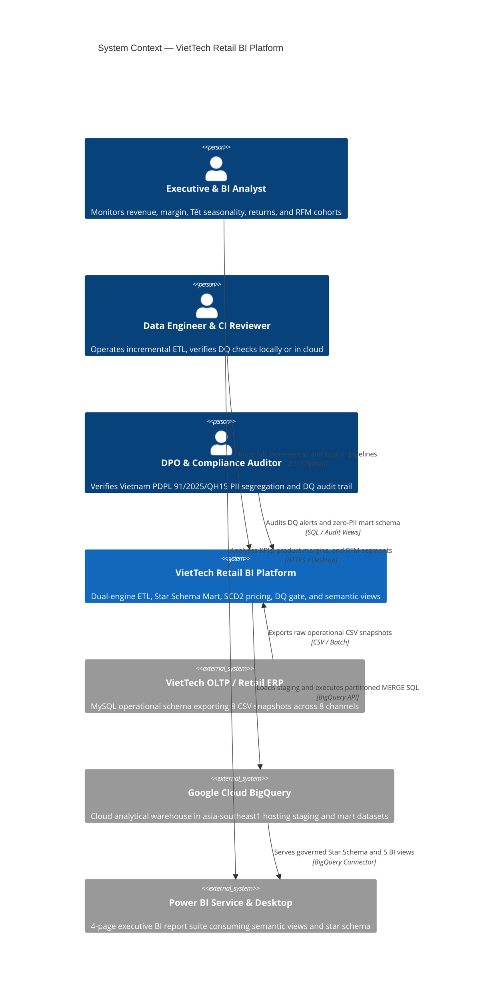
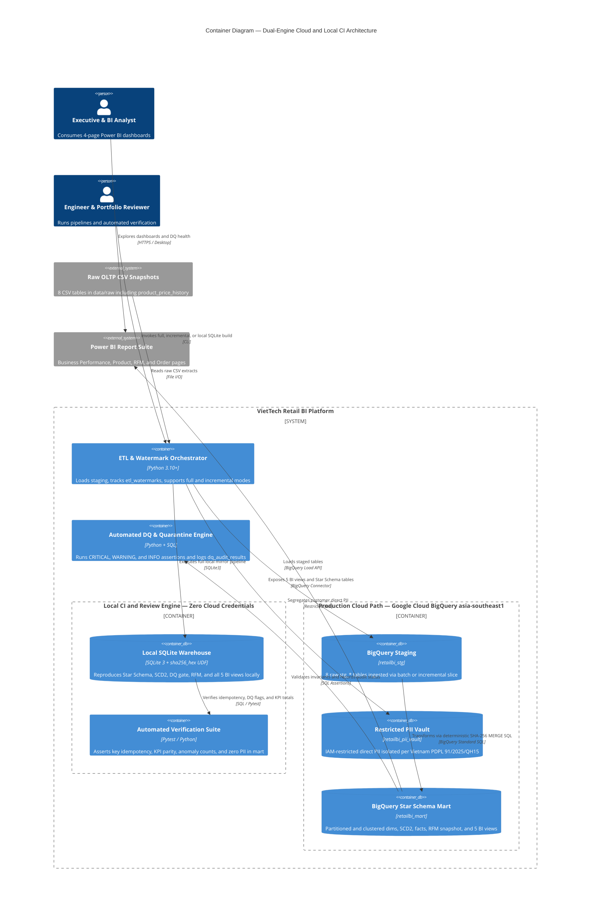
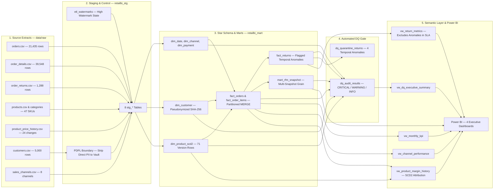
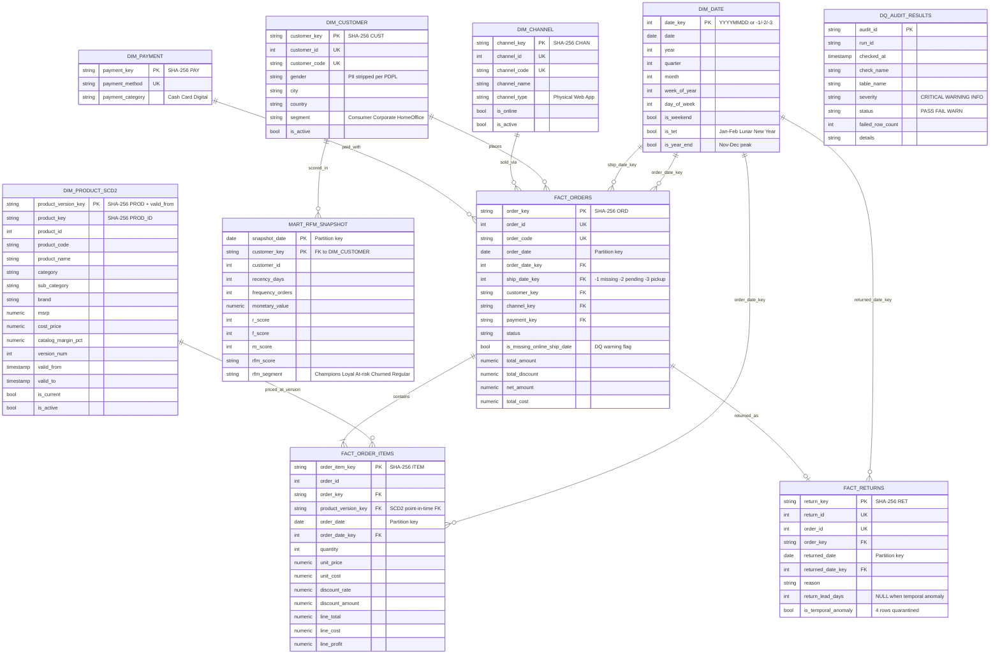

# VietTech Retail BI — System & Data Warehouse Architecture

> **Dataset Disclosure:** All baseline row counts, KPI figures, and incremental benchmark reductions referenced in this document are verified against the fixed **synthetic VietTech Retail dataset** (`2023-01-06` to `2024-12-31`: `21,435` orders, `39,548` order line items, `1,288` returns, `5,000` customers, `47` SKUs across `14` sub-categories, `8` omnichannel sales channels, and `24` historical price/cost changes across `14` SKUs).

---

## 1. Architectural Overview & Decision Index

The VietTech Retail BI Platform transforms raw omnichannel electronics retail extracts (6 Physical stores in Hanoi, Hai Phong, Hue, Da Nang, Ho Chi Minh City, and Can Tho + Web + App) into a governed Kimball Star Schema, multi-snapshot RFM customer segmentation mart, and five Power BI-ready semantic views.

The architecture incorporates four core engineering upgrades documented in formal Architecture Decision Records (ADRs):

| ADR | Decision | Key Problem Solved |
| :--- | :--- | :--- |
| [ADR-001](../decisions/ADR-001-deterministic-surrogate-keys.md) | **Deterministic SHA-256 Surrogate Keys** | Replaces non-idempotent `GENERATE_UUID()` so incremental `MERGE`, multi-snapshot RFM joins, and cross-engine CI parity never break |
| [ADR-002](../decisions/ADR-002-scd-type2-product-pricing.md) | **SCD Type 2 Product Pricing (`dim_product_scd2`)** | Activates `product_price_history` (`24` price/cost changes on `14` SKUs -> `71` versions) for exact point-in-time historical margin attribution |
| [ADR-003](../decisions/ADR-003-incremental-watermark-and-partitioning.md) | **Watermark `MERGE`, Partitioning & Dual-Engine** | Eliminates full-refresh cost (up to `85.92%`–`98.99%` incremental reduction on synthetic slices), adds BigQuery `PARTITION BY`/`CLUSTER BY`, and provides a zero-cloud local SQLite CI runner |
| [ADR-004](../decisions/ADR-004-data-quality-quarantine-and-pdpl-pii.md) | **Tiered DQ Quarantine & Vietnam PDPL PII Segregation** | Isolates `4` real `returned_at < order_date` anomalies, distinguishes `134` Physical pickups (`-3`) from `333` online missing ship dates (`-1`), and removes raw PII from `dim_customer` per Vietnam PDPL `91/2025/QH15` |

---

## 2. C4 Level 1 — System Context Diagram

Shows how business stakeholders, data engineers, compliance auditors, and external source/BI systems interact with the VietTech Retail BI Platform.

---

## 3. C4 Level 2 — Container Diagram (Dual-Engine Architecture)

Illustrates the **Dual-Engine Architecture**: the **Production Cloud Path** on BigQuery (partitioned, clustered, and PII-segregated) alongside the **Local CI & Portfolio Review Path** on SQLite (zero GCP credentials required, bit-identical SHA-256 keys and KPI reconciliation).

---

## 4. End-to-End Data Lineage & Transformation Pipeline

Tracks data flow from raw operational extracts through PDPL pseudonymization, SCD Type 2 timeline reconstruction, Star Schema `MERGE`, automated DQ quarantine, and the 5 governed BI semantic views.

---

## 5. Upgraded Star Schema & Governance ERD

Models the full analytical warehouse (`retailbi_mart`), highlighting deterministic SHA-256 surrogate keys, `dim_product_scd2` point-in-time versioning, PDPL-compliant `dim_customer`, anomaly flags on `fact_orders` and `fact_returns`, composite-grain `mart_rfm_snapshot`, and `dq_audit_results` governance observability.

---

## 6. Storage Optimization, Trust Boundaries & Dataset Baseline

### 6.1 Physical Optimization Matrix (BigQuery vs. Local SQLite)

| Table | BigQuery Partitioning | BigQuery Clustering | Local SQLite Indexing |
| :--- | :--- | :--- | :--- |
| `fact_orders` | `DATE_TRUNC(order_date, MONTH)` | `status, channel_key, customer_key` | Composite index on `(status, order_date_key)` and `(channel_key)` |
| `fact_order_items` | `DATE_TRUNC(order_date, MONTH)` | `product_version_key, order_key` | Indexes on `(order_key)`, `(product_version_key)`, `(order_date_key)` |
| `fact_returns` | `DATE_TRUNC(returned_date, MONTH)` | `is_temporal_anomaly, order_key` | Indexes on `(order_key)`, `(is_temporal_anomaly)` |
| `dim_product_scd2` | Unpartitioned (`71` rows) | `product_id, is_current` | Index on `(product_id, valid_from, valid_to)` |
| `mart_rfm_snapshot` | `snapshot_date` | `rfm_segment, customer_key` | Primary key `(snapshot_date, customer_key)` |
| `dq_audit_results` | `DATE(checked_at)` | `severity, check_name` | Index on `(run_id, severity)` |

### 6.2 Vietnam PDPL (`91/2025/QH15`) Privacy Trust Boundary

- **Zone A — Restricted Staging & PII Vault (`retailbi_stg`, `retailbi_pii_vault`):** Contains raw operational customer fields (`first_name`, `last_name`, `email`, `phone`, `date_of_birth`). Access is restricted to ETL service accounts and DPO-authorized erasure workflows.
- **Zone B — Governed Analytics Mart (`retailbi_mart`):** Strictly **PII-free**. Customers are identified solely by deterministic SHA-256 `customer_key` and non-identifying analytical attributes (`gender`, `city`, `country`, `segment`, `is_active`). Enforced automatically on every build by a `CRITICAL` DQ schema check.

### 6.3 Verified Synthetic Dataset Baseline

| Domain Metric | Verified Value (Synthetic Dataset) | Architectural Relevance |
| :--- | :---: | :--- |
| Date Span | `2023-01-06` to `2024-12-31` | Captures 2 full Vietnamese Tết & Year-End retail cycles |
| Total Orders / Completed Orders | `21,435` / `16,796` | `1,659` Cancelled, `1,288` Returned, `837` Shipped, `661` Processing, `194` Pending |
| Order Line Items | `39,548` | 100% resolved to point-in-time `product_version_key` in `dim_product_scd2` |
| Completed Revenue / Gross Profit | `380,360,467,955 VND` / `107,144,233,955 VND` | `28.17%` gross margin (`273,216,234,000 VND` cost; `13,977,222,045 VND` completed discount) |
| Returned Orders / Return Value | `1,288` / `29,446,815,953 VND` | `4` rows flagged `is_temporal_anomaly = TRUE` (`ret_id = 800, 1100, 1187, 1211`) |
| Completed `NULL ship_date` Audit | `467` total (`134` Physical / `333` Online) | `134` remapped to `-3` (in-store pickup); `333` flagged `-1` + `WARNING` |
| Catalog & Price History | `47` SKUs / `24` changes (`14` SKUs) | `13` `COST` + `11` `MSRP` changes -> `71` SCD2 version rows |
| Incremental Slice Savings | `3,017` (30d) / `216` (1d) orders | **`85.92%`** (30-day) and **`98.99%`** (1-day) workload reduction |
