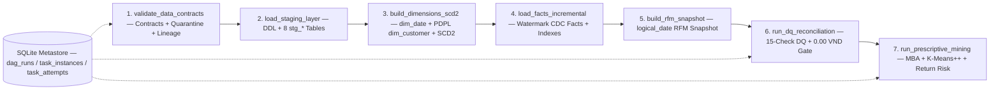

# VietTech BI — Enterprise Data Orchestration Layer

This directory pairs a **zero-dependency Pure-Python State-Machine DAG Orchestrator** (`src/viettech/orchestration/`) with a production-ready **Apache Airflow 2.9+ TaskFlow API DAG** (`orchestration/dags/viettech_retail_elt_dag.py`). Both runtimes enforce the exact same **7-task Retail ELT topology** (`viettech_retail_elt_daily`), validated by automated DAG parity tests in `tests/test_orchestration.py`.

---

## 1. Orchestration Architecture & 7-Task DAG Topology



### Core Capabilities

- **DAG Validation & Deterministic Execution:** Kahn's topological sort with lexicographical tie-breaking, explicit cycle rejection (`CycleDetectedError`), and unknown upstream rejection (`UnknownUpstreamError`).
- **Exponential Backoff Retries & Audit Trail:** Every attempt is persisted in `task_attempts` with exact duration and error trace; exhausted failures fire `on_failure_callback` and short-circuit downstream dependents to `UPSTREAM_FAILED` while independent branches continue.
- **Checkpoint Resume (`--resume-run-id`):** Reloads previously `SUCCESS` tasks from `task_instances`, marks them `SKIPPED` without re-execution, and rehydrates their XCom JSON outputs into downstream tasks.
- **Multi-Date Idempotent Backfill (`--backfill-dates`):** Runs chronological snapshots parameterized by `logical_date` (e.g., building historical `mart_rfm_snapshot` partitions).
- **SLA Breach Detection:** Flags tasks exceeding `sla_seconds` in both `TaskRunResult` and the SQLite metastore (`dag_runs.sla_breaches`, `task_instances.sla_breached`).

---

## 2. Local CLI Usage (`scripts/run_orchestrator.py`)

```bash
# 1. Full end-to-end 7-task Retail ELT run (Contracts -> Star Schema -> DQ -> Mining)
python scripts/run_orchestrator.py --mode full --logical-date 2025-01-01

# 2. Incremental watermark CDC run (skipping prescriptive mining for fast hourly refresh)
python scripts/run_orchestrator.py --mode incremental --watermark "2024-12-02 00:00:00" --logical-date 2025-01-01 --skip-mining

# 3. Checkpoint resume from a previously failed run (skips already-succeeded upstream tasks)
python scripts/run_orchestrator.py --mode full --logical-date 2025-01-01 --resume-run-id <FAILED_RUN_ID>

# 4. Multi-date idempotent historical RFM backfill
python scripts/run_orchestrator.py --mode full --backfill-dates 2024-11-01 2024-12-01 2025-01-01 --skip-mining

# 5. Inspect recent DAG runs & per-task statuses from the SQLite metastore
python scripts/run_orchestrator.py --status
```

---

## 3. Production Apache Airflow 2.9+ / Google Cloud Composer Deployment

Copy `orchestration/dags/viettech_retail_elt_dag.py` into your Airflow `dags/` folder (or GCS Composer bucket `dags/`) and set the runtime environment variables:

```bash
# Local Airflow 2.9+ Docker Quick-Start
export AIRFLOW__CORE__LOAD_EXAMPLES=False
export PYTHONPATH=/opt/airflow/viettech/src
export VIETTECH_PROJECT_ROOT=/opt/airflow/viettech
export VIETTECH_ENGINE=local_sqlite          # Switch to 'bigquery' for GCP Cloud Composer

# Copy DAG into Airflow dags directory
cp orchestration/dags/viettech_retail_elt_dag.py /opt/airflow/dags/

# Trigger a manual backfill or daily run via Airflow CLI
airflow dags list | grep viettech_retail_elt_daily
airflow dags trigger viettech_retail_elt_daily --conf '{"mode": "incremental", "skip_mining": false}'
airflow dags backfill viettech_retail_elt_daily --start-date 2024-11-01 --end-date 2025-01-01
```

In **Google Cloud Composer**, mount the repository package into the Composer Python environment (or Cloud Build artifact), set `VIETTECH_ENGINE=bigquery` and `PROJECT_ID` in Airflow Variables/Environment, and route `viettech.airflow.alerts` JSON logs to Cloud Monitoring / Slack / PagerDuty.

---

## 4. Architectural Comparison: Apache Airflow (Task-Based) vs. Dagster (Asset-Based)

| Dimension | Apache Airflow 2.9+ (TaskFlow API) | Dagster (Software-Defined Assets) |
| :--- | :--- | :--- |
| **Core Abstraction** | **Tasks & DAGs** (`validate -> stage -> dim -> fact -> dq -> mining`) scheduled by time intervals (`logical_date`). | **Data Assets** (`@asset` tables/marts) with declarative upstream asset lineage and freshness policies. |
| **Strengths** | Industry-standard managed offering (**Google Cloud Composer**, AWS MWAA), massive provider ecosystem (BigQuery, GCS, dbt, Slack), mature operational UI & retry/SLA primitives. | First-class asset-level lineage, column/type checks alongside assets, native local unit-testing (`materialize()`), cleaner backfills across partitioned assets. |
| **Trade-offs** | XCom is intended for small metadata payloads only; data lineage requires external catalogs (OpenLineage/Marquez) or custom manifests. | Smaller managed-cloud footprint on GCP compared to Cloud Composer; requires adopting Dagster daemon + asset-centric mental model. |
| **VietTech Alignment** | Chosen as primary cloud target (`viettech_retail_elt_dag.py`) to match **Google BigQuery + Cloud Composer**, augmented by our 38-node `lineage_manifest.json` and pure-Python `DagOrchestrator` for zero-cloud local CI testing. | Easy migration path: each of the 7 `TaskSpec` functions maps 1-to-1 to a Dagster `@asset` / `@asset_check` with zero business-logic rewrite. |
